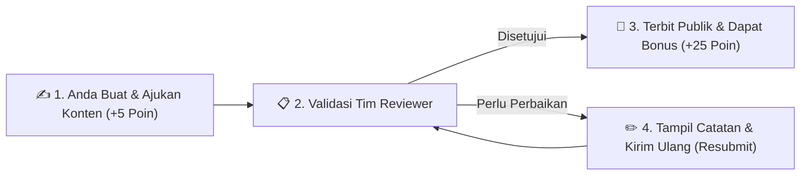

# 📖 Buku Panduan Pengguna GrowHub (User Manual)
**Platform Berbagi Pengetahuan & Gamifikasi Karyawan**  
*Tagline: "Grow Together, Share Knowledge"*

---

## 🌟 Daftar Isi
1. [Mengenal GrowHub](#1-mengenal-growhub)
2. [Hak Akses & Peran Pengguna (Role)](#2-hak-akses--peran-pengguna-role)
3. [Panduan Masuk (Login) & Pengaturan Akun](#3-panduan-masuk-login--pengaturan-akun)
4. [Menjelajahi Menu Utama & Fitur Lipat Sidebar (Bookmark Tab)](#4-menjelajahi-menu-utama--fitur-lipat-sidebar-bookmark-tab)
5. [Panduan Menulis & Membagikan Konten](#5-panduan-menulis--membagikan-konten)
6. [Memantau Status Tulisan & Alur Revisi (Revision & Resubmit)](#6-memantau-status-tulisan--alur-revisi-revision--resubmit)
7. [Interaksi Sosial & Berdiskusi](#7-interaksi-sosial--berdiskusi)
8. [Pusat Belajar Mandiri (Learning Center)](#8-pusat-belajar-mandiri-learning-center)
9. [Komunitas Karyawan (Communities)](#9-komunitas-karyawan-communities)
10. [Sistem Poin, Streak, dan Level Gamifikasi](#10-sistem-poin-streak-dan-level-gamifikasi)
11. [Mengelola Profil Pribadi & Foto Avatar](#11-mengelola-profil-pribadi--foto-avatar)
12. [Panduan Khusus Tim Reviewer (Kurator)](#12-panduan-khusus-tim-reviewer-kurator)
13. [Panduan Khusus Administrator (User, Point, Level, Rank, Policy, Helper & Mail Settings)](#13-panduan-khusus-administrator-user-point-level-rank--policy-settings)
14. [Pertanyaan yang Sering Diajukan (FAQ) & Bantuan](#14-pertanyaan-yang-sering-diajukan-faq--bantuan)
15. [Etika & Aturan Berbagi di GrowHub](#15-etika--aturan-berbagi-di-growhub)

---

## 1. Mengenal GrowHub

### Apa itu GrowHub?
**GrowHub** adalah portal web internal perusahaan yang dirancang khusus bagi seluruh karyawan (baik staf operasional cabang, layanan pelanggan, staf gudang/logistik, administrasi, hingga staf kantor pusat) untuk saling bertukar ilmu, berbagi solusi masalah di lapangan, membaca panduan standar kerja (SOP), dan mengikuti pelatihan mandiri secara interaktif dan menyenangkan.


---

## 2. Hak Akses & Peran Pengguna (Role)

Di dalam sistem GrowHub terdapat 3 peran pengguna:

| Peran (Role) | Siapa Mereka? | Apa yang Bisa Dilakukan? |
| :--- | :--- | :--- |
| **Karyawan (Employee)** | Seluruh karyawan perusahaan. | Membaca feed artikel, menulis ide/tips, berdiskusi, mengikuti kursus pelatihan, mengumpulkan poin reward, dan bergabung di komunitas. |
| **Reviewer (Kurator Konten)** | Tim kurasi materi yang ditunjuk. | Memeriksa kiriman artikel dari karyawan sebelum terbit, menyetujui (*Approve*), atau mengembalikan dengan catatan perbaikan (*Reject with Feedback*). |
| **Administrator (Admin)** | Tim IT, HC/HR pusat, atau PIC Sistem. | Mengelola data karyawan, membantu reset kata sandi, mengatur aturan bobot poin gamifikasi, mengelola jenjang level (*Level Settings*), membatasi kuota peringkat (*Rank Settings*), serta mengatur kebijakan etika komunikasi & moderasi (*Policy and Validation Config*). |

---

## 3. Panduan Masuk (Login) & Pengaturan Akun

### 3.1 Cara Masuk ke Aplikasi
1. Buka peramban (*web browser*) di komputer atau laptop/ponsel Anda (disarankan menggunakan **Google Chrome** atau **Microsoft Edge**).
2. Masukkan alamat URL portal GrowHub perusahaan Anda.
3. Pada halaman Login:
   * **NIP:** Masukkan Nomor Induk Pegawai Anda (9–10 digit angka).
   * **Password Awal:** Masukkan NIP Anda sendiri (jika baru pertama kali login).
4. Klik tombol hijau **"Sign In"**.

```
    ┌──────────────────────────────────────────────┐
    │                MASUK KE GROWHUB              │
    │                                              │
    │   NIP       : [ 198501152010011002         ] │
    │   Password  : [ ••••••••••••••••••         ] │
    │                                              │
    │              [  Tombol SIGN IN  ]            │
    └──────────────────────────────────────────────┘
```

---

### 3.2 Wajib Ganti Password & Verifikasi OTP Email (Login Pertama Kali atau Pasca-Reset)
Demi keamanan akun Anda, sistem secara otomatis mewajibkan verifikasi OTP Email dan pembuatan password baru saat login pertama kali atau setelah password direset oleh Admin:
1. **Tahap 1 — Verifikasi OTP Email:**
   * Setelah berhasil login dengan NIP/password default, sistem akan mengarahkan Anda ke layar **Verifikasi OTP Email** dan mengirimkan kode **OTP 6 digit** ke alamat email perusahaan Anda yang terdaftar.
   * Masukkan 6 digit kode OTP tersebut lalu klik **"Verifikasi OTP"**.
   * Masa berlaku kode OTP adalah **1 menit** (60 detik) dengan batas maksimal **5 kali percobaan salah**. Jika waktu habis, Anda dapat menekan tombol **"Kirim Ulang OTP"** setelah jeda tunggu (*cooldown*) **60 detik**.
2. **Tahap 2 — Set Password Baru:**
   * Setelah OTP terverifikasi, masukkan **Password Baru** yang Anda inginkan (minimal **8 karakter**).
   * Masukkan kembali pada kolom **Konfirmasi Password Baru**.
   * Pastikan kata sandi baru **tidak sama dengan NIP default** Anda.
   * Klik **"Simpan & Lanjutkan"**. Setelah berhasil disimpan, Anda langsung masuk ke halaman utama dan akan melihat pop-up **Pemberitahuan Etika Komunikasi**.

> ⚠️ **Catatan Penting:** Pastikan alamat email akun Anda aktif dan benar agar dapat menerima kode OTP. Harap catat dan ingat kata sandi baru Anda, serta jangan meminjamkan akun kepada orang lain.

---

### 3.3 Bagaimana Jika Lupa Kata Sandi?
* Sistem GrowHub tidak memiliki tombol "Lupa Password Mandiri" untuk karyawan guna mencegah pembobolan akun di komputer user yang mungkin digunakan bergantian.
* Jika Anda lupa password, hubungi **Admin IT/HR**. Admin dapat mereset password Anda kembali ke NIP awal dalam 1 kali klik melalui menu *User Management*.
* Saat login kembali menggunakan NIP tersebut, Anda akan diminta melewati alur **Verifikasi OTP Email** dan membuat password baru seperti pada Bagian 3.2.

---

## 4. Menjelajahi Menu Utama & Fitur Lipat Sidebar (Bookmark Tab)

Antarmuka GrowHub dirancang modern, rapi, dan mudah dinavigasi:

```
┌──────────────┬───────────────────────────────────────────────────────────────┐
│  🌱 GrowHub  │ ⭐ 43 Pts  🔥 14 Days  🏅 Lv.1  [+ Upload Content]  🔔  [AG]  │
├──────────────┼───────────────────────────────────────────────────────────────┤
│ 🏠 Home      │                                                               │
│ 📖 Feed      │                 HALAMAN UTAMA / KONTEN                        │
│ 🎛️ Dashboard │                                                               │
│ 🎓 Learning  │                                                               │
│ 👥 Community │                                                               │
│ 🔖 Saved     │                                                               │
│ 🕘 History   │                                                               │
│ 🏆 Leaderbd  │                                                               │
│              │                                                               │
│ 🏷️ [<]       │   (Klik Tab Pita Penanda Buku untuk Melipat / Membuka Menu!)  │
└──────────────┴───────────────────────────────────────────────────────────────┘
```

### 4.1 Bilah Atas (Header Bar)
* **⭐ Total Poin (`Pts`), 🔥 Api Streak (`Days`), & 🏅 Level (`Lv.X`):** Indikator progres gamifikasi Anda secara *real-time* (diklik langsung menuju **My Dashboard**).
* **➕ Tombol `+ Upload Content`:** Akses cepat dari halaman mana pun untuk membuka formulir unggah konten baru (`/create`).
* **🛡️ Tombol `Reviewer`** *(Khusus Reviewer/Admin)*: Pintasan langsung ke portal kurasi **Content Validation** (`/review`).
* **🔔 Lonceng Notifikasi:** Pemberitahuan instan saat artikel Anda disukai, dikomentari rekan, diverifikasi reviewer, atau menerima bonus poin (`/notifications`).
* **👤 Menu Profil Pengguna (Pojok Kanan Atas):** Klik nama/avatar Anda untuk mengakses **My Profile**, **My Dashboard & Points**, **My Contributions**, serta keluar sistem (**Sign Out (Logout)**).

---

### 4.2 Bilah Menu Samping (Sidebar) yang Terstruktur
Menu navigasi samping dikelompokkan sesuai bagian yang tampil di aplikasi:

1. **MAIN MENU (Menu Utama):**
   * **🏠 Home:** Sambutan personal, ringkasan capaian & *Current Level*, daftar *Top This Week*, kategori pengetahuan, modul rekomendasi, *Trending & Most Helpful*, serta **3 konten yang terakhir Anda lihat (*Recently Viewed*)** lengkap dengan tautan **View More** ke *History Content*.
   * **📖 Knowledge Feed:** Linimasa artikel, tips kerja, dokumentasi visual, dan diskusi antarkaryawan, lengkap dengan kolom **pencarian kata kunci/`#tag`**, filter **8 kategori**, filter tipe media (*All*, *Photos / Images*, *Video Sharing*, *Documents / SOP*), dan pengurutan.
   * **🎛️ My Dashboard:** Dasbor pribadi lengkap dengan kartu *Skill Level*, *Daily Consistency*, ringkasan poin, grafik tren 30 hari, *Badges & Achievements* (8 lencana), serta riwayat buku besar mutasi poin (*Recent Points Ledger*).
   * **🎓 Learning Center:** Modul kursus mandiri (*micro-learning*) untuk mengasah keterampilan kerja.
   * **👥 Communities:** Forum kelompok diskusi berdasarkan bidang kerja atau minat karyawan.
   * **🔖 Saved:** Tempat menyimpan materi favorit agar mudah ditemukan kembali.
   * **🕘 History Content:** Daftar lengkap konten terbit yang pernah Anda buka/baca, diurutkan dari yang terakhir dibuka, lengkap dengan fitur pencarian.
   * **🏆 Leaderboard:** Papan peringkat karyawan paling aktif dan inspiratif.

2. **MY WORKSPACE (Ruang Kerja Saya):**
   * **✏️ My Contributions:** Tempat mengelola seluruh artikel yang pernah Anda buat (*All*, *Published*, *In Review*, *Needs Revision*, dan *Drafts*).

3. **ADMINISTRATION (Khusus Reviewer & Administrator):**
   * **🛡️ Content Validation:** Portal kurasi bagi Reviewer/Admin untuk memvalidasi kiriman artikel.
   * **👥 User Management** *(Admin)*: Portal Admin untuk mengelola akun karyawan.
   * **✨ Point Settings** *(Admin)*: Pengaturan bobot poin per aktivitas, batas harian, dan saklar aktif/nonaktif.
   * **📈 Level Settings** *(Admin)*: Pengaturan jenjang tingkatan level, ambang poin, dan desain lencana.
   * **🏆 Rank Settings** *(Admin)*: Pengaturan batas kuota peringkat teratas (*Top Ranks*) dan jadwal reset Leaderboard.
   * **⚖️ Policy and Validation Config** *(Admin)*: Pengaturan daftar aturan etika komunikasi, pesan pengurangan poin pelanggaran (`-1 Pts`), serta pratinjau pop-up pengumuman login.

> 💡 **Kenyamanan Tampilan (*Loading Skeleton*):** Selama proses pengambilan data dari server, seluruh halaman menampilkan animasi kerangka muat (*loading skeleton*) yang rapi agar ukuran tata letak (*layout*) tetap stabil tanpa pergeseran mendadak. *(Halaman bantuan lengkap **Help & Support** juga dapat diakses melalui rute `/help` untuk melihat panduan poin, FAQ, dan pengajuan tiket bantuan).*

---

### 4.3 🏷️ Fitur Lipat Sidebar Berbentuk Pita Penanda Buku (Bookmark Tab)
Ingin membaca artikel panjang atau modul pelatihan dengan layar yang lebih luas dan bebas gangguan?
* Di tepi samping kanan sidebar, terdapat **Tombol Tab Pita Penanda Buku (Bookmark Tab)** yang unik.
* **Cara Menggunakan:**
  * Klik tab pita penanda buku tersebut untuk **melipat / menyembunyikan sidebar** ke samping kiri. Halaman baca akan otomatis melebar memenuhi layar.
  * Untuk **memunculkan kembali menu sidebar**, cukup klik kembali tab pita penanda buku yang tetap menempel rapi di sisi kiri layar.

---

## 5. Panduan Menulis & Membagikan Konten

Mempunyai kiat sukses meningkatkan penjualan produk baru? Cara cepat menghitung stok opname? Bagikan ke rekan kerja Anda!

### 5.1 Alur Kurasi & Penerbitan Konten



---

### 5.2 Langkah-Langkah Mengisi Formulir Konten
1. Klik tombol hijau **"+ Upload Content"** di Header Bar, **"+ Share Knowledge & Ideas"** di Home, atau **"+ Create Content"** / **"+ Create New Content"** di Feed/My Contributions.
2. **Judul Konten (Wajib):**
   * Buat judul yang jelas dan informatif (maksimal 200 karakter).
   * *Contoh:* *"5 Cara Efektif Mengurangi Antrean Panjang di Kasir Saat Akhir Pekan"*.
3. **Isi Pembahasan (Wajib):**
   * Uraikan situasi yang dihadapi, langkah kerja praktis yang dilakukan, kendala, dan hasil positif yang diperoleh tim atau unit kerja.
   * Minimal 20 karakter. Anda dapat menggunakan format paragraf dan poin-poin.
4. **Lampiran Media (Foto / Video / Berkas SOP):**
   * Unggah dokumen pendukung seperti foto dokumentasi kerja (JPG/PNG/WEBP), video tutorial singkat (MP4/WEBM), atau dokumen pedoman (PDF, Word, Excel, PowerPoint).
   * Kapasitas maksimal: hingga **50 MB per file** (maks. 10 file) dengan dukungan multi-upload.
5. **Kategori Konten (Wajib):**
   * *Best Practice* (Praktik Terbaik Teruji)
   * *Tips & Trick* (Kiat Praktis Kerja)
   * *Lesson Learned* (Pelajaran Berharga dari Kendala Lapangan)
   * *Innovation & Ideas* (Gagasan atau Usulan Inovasi Baru)
   * *Document / SOP* (Standar Operasional Prosedur Resmi)
   * *Success Story* (Kisah Sukses Pencapaian Target Kerja)
   * *Group Discussion* (Diskusi Terbuka Antarkaryawan)
   * *Video & Photo* (Berbagi Momen dan Pengetahuan Lewat Visual)
6. **Hubungkan ke Komunitas (Opsional):**
   * Pilih komunitas spesifik jika materi ditujukan untuk kelompok tertentu, atau pilih *General* jika untuk seluruh karyawan.
7. **Kata Kunci / Tag (#):**
   * Ketik tag pendukung lalu tekan Enter (misal: `#kasir`, `#display`, `#sop`, `#pelayanan`).
8. **Simpan atau Kirim:**
   * **Save as Draft:** Jika tulisan belum selesai dan ingin dilanjutkan nanti.
   * **Submit for Review:** Ajukan tulisan ke tim kurator. Anda otomatis mendapatkan **+5 Poin** saat pengajuan berhasil!

---

## 6. Memantau Status Tulisan & Alur Revisi (Revision & Resubmit)

Di menu **"My Contributions" (Kontribusi Saya)**, Anda dapat memantau status setiap tulisan yang pernah dibuat melalui tab status:

| Status Tab | Arti Status | Yang Perlu Dilakukan |
| :--- | :--- | :--- |
| 🟡 **In Review (Menunggu)** | Tulisan Anda sedang dalam antrean evaluasi oleh tim Reviewer. | Menunggu verifikasi (biasanya 1–2 hari kerja). |
| 🟢 **Published (Terbit)** | Tulisan Anda lolos kurasi dan resmi tayang di Knowledge Feed! | Selamat! Poin apresiasi **+25 Poin** otomatis masuk ke akun Anda. |
| 🔴 **Needs Revision (Revisi)** | Reviewer meminta perbaikan (misal foto kurang jelas atau langkah kerja kurang lengkap). | Ikuti panduan revisi dan kirim ulang di bawah ini. |
| ⚪ **Draft (Draf)** | Tulisan yang baru Anda simpan sendiri dan belum diajukan. | Klik tombol *Edit*, lengkapi tulisan, lalu klik *Submit for Review*. |

---

### 6.1 Alur Transparan Revisi & Kirim Ulang (Resubmit)
Jika tulisan Anda berstatus **Needs Revision (Perlu Perbaikan)**:
1. Buka menu **My Contributions** dan pilih tab **Needs Revision**.
2. Klik tombol **Edit** pada tulisan tersebut.
3. Anda akan melihat **Kotak Peringatan Khusus Berwarna Merah** di bagian atas formulir yang memuat **Catatan Revisi Langsung dari Reviewer**.
4. Perbaiki bagian yang diminta (misalnya memperjelas langkah kerja atau mengganti foto lampiran).
5. Setelah selesai diperbaiki, klik tombol hijau **"Resubmit for Review"**.
6. Konten akan kembali masuk ke antrean reviewer untuk disetujui tanpa perlu membuat tulisan baru dari nol!

---

## 7. Interaksi Sosial & Berdiskusi

GrowHub mengedepankan kolaborasi aktif antarkaryawan:
* **Suka (Like) ❤️:** Mengapresiasi tulisan rekan kerja yang bermanfaat. Penulis mendapatkan **+2 Poin**.
* **Simpan (Bookmark) 🔖:** Menandai materi penting agar tersimpan di menu *Saved Knowledge* pribadi Anda.
* **Komentar Diskusi 💬:** Berikan komentar atau pertanyaan yang santun. Anda mendapatkan **+1 Poin**, dan pemilik tulisan mendapatkan **+3 Poin** karena tulisannya memicu diskusi produktif.
* **Bagikan (Share) 🔗:** Bagikan tautan artikel langsung ke WhatsApp Web rekan kerja atau salin link materi.

---

## 8. Pusat Belajar Mandiri (Learning Center)

Asah keterampilan operasional Anda melalui modul kursus singkat (*micro-learning*):
1. Buka menu **Learning Center**.
2. Pilih modul yang tersedia (misalnya: *Service Excellence 101*, *Data-Driven Analytics dengan Excel*, atau *Keamanan & Keselamatan Kerja*).
3. Pelajari rangkuman materi, baca langkah kerja, dan tonton video tutorial yang disediakan.
4. Jika telah memahami seluruh isi materi, klik tombol hijau **"Complete Course"** / **"Mark as Completed"**.
5. Sistem akan memberikan lencana centang hijau dan mentransfer poin pembelajaran (bawaan **+15 Poin**, sesuai konfigurasi *Point Settings*) langsung ke profil Anda!

---

## 9. Komunitas Karyawan (Communities)

* **Bergabung ke Komunitas:** Buka menu **Communities**, cari grup yang sesuai dengan bidang Anda (seperti *Store Operations Squad*, *Customer Care Champions*, atau *Logistics & Inventory*), lalu klik tombol **"Join Community"**.
* **Manfaat:** Anda dapat membaca kiriman materi yang khusus dibagikan bagi anggota komunitas dan berdiskusi dengan rekan seprofesi dari berbagai cabang.
* **Membuat Komunitas Baru:** Klik tombol **"+ Create New Community"**, isi nama komunitas, jelaskan tujuannya, dan pilih ikon warna representatif.

---

## 10. Sistem Poin, Streak, dan Level Gamifikasi

### 10.1 Tabel Perolehan Poin Harian
Kumpulkan poin sebanyak-banyaknya melalui aktivitas bermanfaat:

| Aktivitas Karyawan | Hadiah Poin | Keterangan |
| :--- | :---: | :--- |
| **Login Pertama Setiap Hari** | **+2 Poin** | Menjaga api keaktifan (*streak*) tetap menyala. |
| **Mengajukan Konten ke Reviewer** | **+5 Poin** | Diberikan saat pertama kali mengirim draf ke kurasi. |
| **Konten Lolos Kurasi & Terbit** | **+25 Poin** | Hadiah utama atas sumbangsih ilmu bagi perusahaan. |
| **Menerima Like dari Rekan Kerja** | **+2 Poin** | Setiap ada rekan yang menyukai karya Anda. |
| **Menerima Komentar di Tulisan Anda** | **+3 Poin** | Ketika artikel Anda menghasilkan diskusi bermanfaat. |
| **Menulis Komentar Positif** | **+1 Poin** | Berpartisipasi dalam diskusi di tulisan rekan lain. |
| **Membaca Artikel Rekan Kerja** | **+1 Poin** | Menambah wawasan dari artikel di feed. |
| **Membagikan Materi (Share)** | **+1 Poin** | Menyebarkan artikel bermanfaat ke rekan kerja. |
| **Menuntaskan Kursus Pelatihan** | **+15 Poin** | Menyelesaikan modul di Learning Center (sesuai aturan *Point Settings*). |
| **Bonus Mingguan (Streak 7 Hari) 🔥** | **+15 Poin Ekstra** | Bonus ekstra setiap aktif 7 hari berturut-turut! |

> 💡 **Informasi Tambahan:** Besaran poin dan kuota harian (*daily caps*) dapat disesuaikan sewaktu-waktu oleh Administrator melalui *Point Settings*. Sebaliknya, pelanggaran etika komunikasi pada kolom komentar dapat menyebabkan pengurangan poin otomatis sesuai kebijakan aktif.

---

### 10.2 Apa itu Daily Streak (Api Konsistensi)?
* Indikator **Daily Streak (🔥)** menghitung jumlah hari berturut-turut Anda membuka dan aktif di GrowHub.
* **Perhatian:** Jika Anda libur atau tidak membuka GrowHub sama sekali dalam 1 hari kalender kerja, angka streak akan kembali ke 1. Jaga agar api konsistensi Anda tetap membara!

---

### 10.3 Jenjang Tingkatan Level (8 Level Bawaan)
Akumulasi poin Anda akan menentukan tingkatan level gelar kehormatan Anda di perusahaan:

```
  🌱 Level 1: Seedling (0 - 99 Pts)           — Langkah awal menanam benih pengetahuan
  🌿 Level 2: Sprout (100 - 249 Pts)          — Tunas mulai tumbuh aktif membaca & berbagi
  🪴 Level 3: Sapling (250 - 499 Pts)         — Pohon muda yang giat berdiskusi
  🌳 Level 4: Grower (500 - 899 Pts)          — Rutin membagikan tips kerja berkualitas
  🌾 Level 5: Cultivator (900 - 1.399 Pts)    — Penggerak komunitas yang menginspirasi
  🍎 Level 6: Harvester (1.400 - 1.999 Pts)   — Menuai banyak manfaat dan membimbing rekan
  ⭐ Level 7: Mentor (2.000 - 2.999 Pts)      — Teladan rujukan ilmu di seluruh cabang
  👑 Level 8: Evergreen (3.000+ Pts)          — Legenda pengetahuan yang kokoh & abadi
```

*(Catatan: Nama level, ambang batas poin, warna lencana, dan jumlah tingkatan level dapat disesuaikan atau ditambah oleh Administrator melalui panel Level Settings).*

---

### 10.4 Leaderboard (Papan Peringkat)
Buka menu **Leaderboard** untuk melihat prestasi Anda dan rekan-rekan kerja:
* **Batas Kuota Peringkat Teratas (Top X):** Leaderboard menampilkan kuota peringkat teratas (misalnya: **Top 10**, **Top 25**, **Top 50**, atau **Top 100**) sesuai konfigurasi batas yang diatur oleh Administrator.
* **Informasi Siklus Reset Leaderboard:** Pada bagian atas Leaderboard terdapat lencana indikator siklus kompetisi:
  * ♾️ **Tanpa Reset (Sepanjang Waktu):** Seluruh poin dihitung secara kumulatif sejak pertama kali bergabung.
  * 🔄 **Reset Berkala (Mingguan / Bulanan / Triwulan / Tahunan):** Poin leaderboard akan mulai dihitung segar dari awal setiap siklus baru, memberikan peluang adil bagi seluruh karyawan (termasuk karyawan baru) untuk meraih podium juara!
  * *(Catatan: Level keahlian dan lencana Seedling hingga Evergreen Anda tetap abadi dan tidak terhapus).*
* **Filter Waktu:**
  * **This Week (Minggu Ini):** Persaingan paling hangat dalam 7 hari terakhir.
  * **This Month (Bulan Ini):** Akumulasi prestasi sepanjang bulan berjalan.
  * **All-Time (Sepanjang Masa):** Gelar kehormatan tertinggi karyawan terbaik perusahaan.
* **Filter Departemen:** Saring daftar untuk melihat persaingan rekan satu divisi kerja Anda sendiri.
* **Panggung Podium Top 3:** Menampilkan juara 1 (Emas), juara 2 (Perak), dan juara 3 (Perunggu) secara visual di atas tabel utama.
* **Kartu Posisi Peringkat Pribadi (Sticky Footer):**
  * Terletak di bagian bawah layar; jika Anda masuk dalam kuota Top X, kartu akan menampilkan nomor peringkat Anda.
  * Jika Anda belum masuk ke dalam kuota Top X (misal peringkat #68 dari batas Top 50), kartu tetap menampilkan posisi aktual Anda disertai keterangan motivasi untuk terus aktif menembus batas Top X!

---

## 11. Mengelola Profil Pribadi & Foto Avatar

Halaman profil adalah portofolio keaktifan Anda di hadapan seluruh rekan kerja:
1. Klik nama Anda di pojok kanan atas *Header Bar* lalu pilih **My Profile** (`/profile`).
2. **Perbarui Data Profil (`Edit Profile`):** Anda dapat memperbarui **Nama Lengkap**, **Alamat Email** *(wajib diisi untuk keperluan pengiriman OTP Email)*, **Lokasi Cabang/Kantor**, dan **Bio**.
3. **Ganti Foto Profil (Avatar):**
   * Klik ikon **Kamera** pada lingkaran foto profil Anda.
   * Pilih foto resmi atau foto kerja terbaik Anda (format gambar JPG/PNG/GIF/WEBP, ukuran maksimal **3 MB**). Foto akan langsung terpasang!
4. **Ubah Password (Khusus Administrator / Status Wajib Ganti Password):**
   * Administrator dapat mengganti password melalui tab **Edit Profile** menggunakan verifikasi **Password Saat Ini** dan **OTP Email 6 digit** yang dikirim ke email terdaftar. Bagi karyawan reguler, reset password tetap dilakukan secara terpusat oleh Administrator.
5. **Melihat Statistik Pribadi & Konten Terbit:**
   * Pantau ringkasan `PUBLISHED POSTS`, `TOTAL LIKES EARNED`, `COURSES COMPLETED`, `COMMUNITIES JOINED`, serta daftar konten yang telah Anda terbitkan. Untuk rincian mutasi poin masuk dan pengurangan poin (*Recent Points Ledger*), buka menu **My Dashboard**.

---

## 12. Panduan Khusus Tim Reviewer (Kurator)

*(Bagian ini khusus untuk pengguna yang ditunjuk sebagai Reviewer)*

Sebagai kurator, Anda bertugas memastikan kualitas informasi yang beredar di perusahaan tetap akurat, bermanfaat, dan santun.

### 12.1 Cara Memvalidasi Konten Masuk
1. Klik menu **"Content Validation"** di sidebar.
2. Pada antrean **Pending Queue**, klik artikel yang ingin diperiksa.
3. Tinjau isi tulisan, kejelasan panduan, serta kesesuaian lampiran foto/video dengan SOP perusahaan.
4. Ambil keputusan:
   * **Approve & Publish:** Klik tombol hijau jika konten berkualitas. Artikel seketika terbit di feed publik, penulis mendapatkan **+25 Poin**, dan Reviewer mendapatkan poin evaluasi.
   * **Reject (Needs Revision):** Jika artikel butuh perbaikan, klik tombol merah `Reject (Needs Revision)`. **Wajib tuliskan catatan revisi yang jelas** (misal: *"Mohon lengkapi detail langkah kerja pada poin nomor 2"*). Catatan ini akan tampil di form edit penulis.

---

## 13. Panduan Khusus Administrator (User, Point, Level, Rank & Policy Settings)

*(Bagian ini khusus untuk tim IT, HC/HR, dan PIC Sistem dengan hak akses Administrator)*

Administrator memiliki kontrol menyeluruh atas operasional dan konfigurasi sistem gamifikasi tanpa perlu menyentuh kode pemrograman:

### 13.1 Manajemen Pengguna (User Management)
* **Pencarian & Filter Cepat:** Cari data karyawan berdasarkan Nama, NIP, Departemen, atau Lokasi Cabang.
* **Tambah Karyawan Baru:** Masukkan NIP, Nama Lengkap, Email, Departemen, dan Role. Terdapat opsi memberikan *Welcome Bonus Points*.
* **Reset Password 1-Klik:** Jika ada karyawan yang lupa kata sandi, Admin cukup menekan tombol **"Reset Password ke NIP"**. Akun karyawan akan kembali ke password NIP dan wajib mengganti kata sandi saat login berikutnya.
* **Penyesuaian Poin Manual:** Admin dapat menambahkan atau mengoreksi saldo poin karyawan secara langsung untuk keperluan apresiasi khusus.

---

### 13.2 Pengaturan Sistem Poin Dinamis (Point Settings)
Diakses melalui menu **"Point Settings"** (`/admin/point-rules`):
* **Ubah Nilai Poin:** Ubah bobot poin per aksi (login harian, buat artikel, kursus, like, dll) menggunakan input angka atau tombol stepper (+/-).
* **Saklar On/Off Mandiri (Instant Toggle):** Aktifkan atau nonaktifkan aturan poin tertentu kapan saja dengan menekan tombol saklar geser. Aksi yang dimatikan akan otomatis menghasilkan 0 poin.
* **Atur Batas Harian (Daily Cap):** Tentukan batas maksimal frekuensi perolehan poin per hari untuk mencegah kecurangan/spamming.
* **Simpan Perubahan Massal:** Klik tombol hijau **"Simpan Semua Perubahan"** untuk menerapkan seluruh konfigurasi sekaligus.
* **Tombol Cepat:** Tersedia tombol **"Aktifkan Semua"**, **"Nonaktifkan Semua"**, serta **"Reset Default"** untuk mengembalikan aturan ke setelan pabrik.

---

### 13.3 Pengaturan Jenjang Level Dinamis (Level Settings)
Diakses melalui menu **"Level Settings"** (`/admin/level-rules`):
* **Kelola Tingkatan Level:** Ubah nama level, tingkatan tier, serta ambang batas minimal poin (*min points*) yang harus diraih karyawan untuk mencapai level tersebut.
* **Kustomisasi Tampilan Lencana (Badge):** Pilih ikon lencana (Sprout, Leaf, Tree, Flame, Award, Star, Sparkles, Crown) dan warna representatif untuk setiap level.
* **Tambah Level Baru:** Tambahkan tingkatan level baru di atas level yang sudah ada jika perusahaan ingin memperpanjang jenjang karir gamifikasi karyawan.
* **Level Progression Roadmap:** Lihat visualisasi alur tangga kenaikan level dan jumlah karyawan yang sedang berada di setiap tingkatan level.
* **Simpan Massal & Reset Default:** Simpan seluruh modifikasi level dalam satu klik atau kembalikan ke struktur 8-tier bawaan sistem.

---

### 13.4 Pengaturan Batas Peringkat & Jadwal Reset (Rank Settings)
Diakses melalui menu **"Rank Settings"** (`/admin/rank-settings`):

1. **Jadwal & Siklus Reset Leaderboard (`reset_frequency`):**
   * Admin memiliki wewenang penuh untuk mengatur kapan skor Leaderboard direset ulang atau membiarkannya berjalan tanpa pernah direset:
     * ♾️ **Tidak Pernah Reset (Sepanjang Waktu / Never):** Poin dihitung secara kumulatif dari seluruh riwayat kontribusi karyawan tanpa batasan waktu.
     * 📅 **Reset Mingguan (Weekly):** Papan peringkat otomatis direset setiap hari Senin pukul 00:00 untuk memulai kompetisi mingguan baru.
     * 🗓️ **Reset Bulanan (Monthly):** Papan peringkat otomatis direset setiap tanggal 1 awal bulan pukul 00:00.
     * 🏢 **Reset Per Triwulan (Quarterly):** Papan peringkat otomatis direset setiap 3 bulan sekali (Januari, April, Juli, Oktober).
     * 🎆 **Reset Tahunan (Yearly):** Papan peringkat otomatis direset setiap 1 Januari awal tahun.
   * **Informasi Tanggal & Waktu:** Sistem otomatis menampilkan jadwal tanggal reset berikutnya (*Next Reset Date*) dan waktu reset terakhir yang pernah dilakukan.

2. **Tindakan Reset Instan Sekarang (*Manual Reset Now*):**
   * Tombol **"Reset Leaderboard Sekarang"** memungkinkan Admin membuka musim kompetisi baru seketika di luar jadwal reguler (misalnya saat pembukaan cabang baru atau perlombaan khusus perusahaan).
   * Seluruh hitungan peringkat leaderboard akan dimulai dari 0 sejak saat tombol ditekan.
   * Admin juga dapat menekan **"Batalkan Reset Manual"** kapan saja untuk mengembalikan leaderboard ke siklus normal.
   * *(Penting: Level akumulasi gelar karyawan Lv.1 Seedling s/d Lv.8 Evergreen tidak akan hilang dan tetap aman).*

3. **Batas Kuota Peringkat Leaderboard (`leaderboard_limit`):**
   * Mengatur berapa banyak karyawan teratas yang diambil dari basis data dan ditampilkan pada tabel Leaderboard utama.
   * Pilihan preset cepat: **Top 10**, **Top 20**, **Top 25**, **Top 50**, dan **Top 100**, serta tombol stepper dan slider manual (rentang 3 hingga 500 karyawan).

4. **Batas Peringkat Widget Beranda (`home_widget_limit`):**
   * Mengatur kuota karyawan terbaik mingguan yang ditampilkan pada kartu ringkasan di halaman Beranda (pilihan preset: **Top 3**, **Top 5**, atau **Top 10** mingguan).

5. **Saklar Panggung Podium Top 3 (`show_podium`):**
   * Saklar geser On/Off untuk mengaktifkan atau menyembunyikan panggung visual medali Emas (#1), Perak (#2), dan Perunggu (#3) di bagian atas Leaderboard.

6. **Saklar Transparansi Posisi Pribadi di Luar Top Limit (`show_my_rank_outside`):**
   * Mengatur apakah karyawan yang berada di luar kuota Top X (misal rank #75) tetap dapat melihat nomor posisi aslinya di kartu sticky bawah untuk memacu motivasi sportif.

7. **Pratinjau Langsung (*Live Interactive Simulation Preview*):**
   * Kolom pratinjau interaktif di sisi kanan formulir yang menyajikan simulasi visual nyata tampilan Leaderboard (mockup podium, tabel, dan sticky footer) secara *real-time* saat Admin mengubah kuota atau jadwal reset sebelum disimpan.

8. **Reset Default Bawaan:**
   * Tombol 1-klik untuk mengembalikan seluruh pengaturan ke nilai standar sistem (Siklus: Tanpa Reset, Top 50 Leaderboard, Top 5 Beranda, Podium Aktif).

---

### 13.5 Pengaturan Kebijakan Etika & Moderasi (`Policy and Validation Config`)
Diakses melalui menu **"Policy and Validation Config"** (`/admin/policy-config`):
* **Kelola Daftar Aturan Etika Komunikasi:** Tambah, ubah, simpan massal (*batch save*), atau hapus poin aturan pelanggaran (`title`, `description`, `sort_order`). Minimal 1 aturan harus selalu dipertahankan di sistem.
* **Konfigurasi Punishment Poin Dinamis:** Besaran pengurangan poin tidak lagi statis -1 Pts untuk semua jenis pelanggaran. Admin dapat mengatur sanksi poin secara spesifik untuk masing-masing pelanggaran:
  - **Tingkat Berat (High):** Pengurangan poin lebih besar (misal: `-5 Pts` untuk kebocoran data rahasia atau ujaran kebencian/SARA).
  - **Tingkat Sedang (Medium):** Pengurangan poin menengah (misal: `-3 Pts` untuk spamming/manipulasi poin, `-2 Pts` untuk promosi pribadi).
  - **Tingkat Ringan (Low):** Pengurangan poin standar (misal: `-1 Pts` untuk informasi yang kurang akurat/tidak resmi).
* **Pratinjau Pop-up Login:** Gunakan fitur pratinjau untuk melihat tampilan **Pemberitahuan Etika Komunikasi** lengkap dengan label sanksi poin per pelanggaran yang wajib dibaca dan disetujui (*Saya Mengerti & Setuju*) oleh setiap karyawan setelah login.
* **Moderasi Komentar Pelanggaran:** Saat Admin menghapus komentar karyawan lain pada detail konten, Admin wajib memilih salah satu alasan pelanggaran dari daftar aktif ini. Sistem otomatis menghapus komentar beserta balasannya, memotong poin pemilik komentar sesuai besaran sanksi aturan tersebut (`policy_violation`), mengirim notifikasi in-app, serta mengirim email pemberitahuan pelanggaran resmi ke email karyawan.

### 13.6 Manajemen Kontak Helper & Layanan Bantuan (`Helper Contacts`)
Diakses melalui menu samping Administrator **"Helper Contacts"** (`/admin/helper-contacts`) atau melalui tombol **"Kelola Kontak Helper"** di halaman Help & Support:
* **Fungsi Utama:** Mengelola saluran bantuan resmi (Helpdesk IT, Human Capital Care, Hotline Darurat) yang dapat dihubungi karyawan.
* **Tampil Otomatis di Halaman Login & Support:** Setiap kontak dengan status **Aktif** akan otomatis ditampilkan di:
  1. **Halaman Login (`/login`):** Tersedia tombol melayang (*Flying Button / FAB*) berikon headphone di sudut kanan bawah layar di luar kartu login. Saat diklik, tombol ini menampilkan jendela pop-up modal *Pusat Bantuan & Kontak Helper* sehingga karyawan yang lupa password, akun terkunci, atau belum menerima OTP dapat langsung menghubungi kontak bantuan resmi via WhatsApp, Email, Telepon, atau Telegram tanpa harus login terlebih dahulu.
  2. **Halaman Help & Support (`/help`):** Ditampilkan sebagai kartu kontak bantuan resmi berfitur tombol aksi langsung (*Chat WhatsApp*, *Kirim Email*, *Hubungi Telepon*).
* **Fitur Manajemen Admin:**
  - **Tambah Kontak Helper:** Masukkan nama layanan/PIC, jabatan, jenis saluran (*WhatsApp*, *Email*, *Telepon*, *Telegram*), nomor/alamat kontak, jam operasional, dan keterangan bantuan.
  - **Ubah & Nonaktifkan:** Nonaktifkan sementara kontak helper saat di luar jam dinas hanya dengan 1-klik tombol toggle.
  - **Reset Default:** Kembalikan konfigurasi kontak helper ke 3 kontak bawaan sistem kapan pun dibutuhkan.

### 13.7 Pengaturan Email & Server SMTP (`Mail & SMTP Settings`)
Diakses melalui menu samping Administrator **"Mail Settings"** (`/admin/mail-settings`):
* **Fungsi Utama:** Memberikan wewenang kepada Administrator untuk mengonfigurasi kredensial SMTP server secara visual langsung dari antarmuka web GrowHub tanpa perlu mengedit file server secara manual.
* **Sinkronisasi Otomatis Database & File `.env`:**
  - Setiap perubahan yang disimpan oleh Admin akan langsung memperbarui data di tabel database `mail_settings` dan baris konfigurasi `MAIL_*` pada file `backend/.env`.
  - Konfigurasi runtime Laravel langsung diperbarui seketika dan cache konfigurasi dibersihkan (`config:clear`) sehingga seluruh pengiriman email (seperti OTP ganti password dan email notifikasi pelanggaran etika) langsung menggunakan kredensial baru.
* **Kolom Pengaturan yang Dapat Dikonfigurasi:**
  1. **Mail Driver / Mailer (`MAIL_MAILER`):** `smtp`, `sendmail`, `log`, dsb.
  2. **Mail Scheme / Enkripsi (`MAIL_SCHEME`):** `smtps` (untuk koneksi SSL port 465), `tls`, `ssl`, atau dikosongkan.
  3. **SMTP Host Server (`MAIL_HOST`):** Alamat server SMTP (contoh: `smtp-1.rcoid.com` atau `smtp.gmail.com`).
  4. **SMTP Port (`MAIL_PORT`):** Port server (contoh: `465` untuk SMTPS/SSL, `587` untuk STARTTLS).
  5. **SMTP Username (`MAIL_USERNAME`):** Username/alamat akun email login SMTP (contoh: `noreply.pepito@rcoid.com`).
  6. **SMTP Password (`MAIL_PASSWORD`):** Kata sandi akun email SMTP. Kolom ini dilengkapi tombol intip (*show/hide*) dan dapat dikosongkan jika Admin hanya ingin mengubah host/port tanpa merubah password lama yang tersimpan.
  7. **Email Pengirim / From Address (`MAIL_FROM_ADDRESS`):** Alamat email resmi pengirim (contoh: `noreply.pepito@rcoid.com`).
  8. **Nama Pengirim / From Name (`MAIL_FROM_NAME`):** Nama identitas sistem yang terlihat di kotak masuk penerima (contoh: `GrowHub- ${APP_NAME}`).
* **Fitur Uji Coba Pengiriman Email (*Live SMTP Test Tool*):**
  - Pada sisi kanan halaman konfigurasi terdapat panel **Uji Coba Pengiriman Email**.
  - Masukkan alamat email tujuan pengujian lalu tekan **"Kirim Email Uji Coba"**.
  - Sistem akan langsung mencoba menghubungkan socket ke SMTP host dan port yang dikonfigurasi serta mengirimkan email uji coba berformat resmi GrowHub.
  - Jika terjadi kendala koneksi (misal port diblokir firewall, salah password, atau hostname tidak dikenal), sistem akan menampilkan pesan galat (*diagnostic error*) secara terperinci untuk mempermudah investigasi tim IT.

---

## 14. Pertanyaan yang Sering Diajukan (FAQ) & Bantuan

#### 1. "Saya tidak sengaja salah memasukkan kata sandi hingga terkunci, atau tidak menerima kode OTP, apa yang harus saya lakukan?"
> **Solusi:** Hubungi Supervisor atau Admin IT/HR perusahaan Anda. Admin dapat mereset kata sandi Anda kembali ke NIP awal dan memastikan alamat email Anda sudah terdaftar dengan benar agar kode OTP verifikasi 6 digit dapat terkirim saat Anda login ulang.

#### 2. "Berapa lama waktu peninjauan artikel oleh Reviewer?"
> **Solusi:** Kurasi artikel biasanya berlangsung antara 1x24 jam hingga 2x24 jam kerja. Anda akan menerima notifikasi otomatis ketika artikel disetujui atau memerlukan revisi.

#### 3. "Bagaimana cara membaca artikel dengan tampilan layar penuh tanpa menu samping?"
> **Solusi:** Cukup klik **Tombol Tab Pita Penanda Buku (Bookmark Tab)** di tepi kanan sidebar. Menu samping akan terlipat rapi dan area baca menjadi lebih luas. Klik kembali tab penanda buku untuk membuka menu.

#### 4. "Mengapa tulisan saya berstatus 'Needs Revision' dan bagaimana cara memperbaikinya?"
> **Solusi:** Buka menu **My Contributions** > tab **Needs Revision** > klik **Edit**. Di bagian atas formulir akan tampil kotak merah berisi masukan dari kurator. Perbaiki sesuai petunjuk lalu klik **"Resubmit for Review"**.

#### 5. "Berapa kapasitas maksimal lampiran file konten dan foto profil yang bisa saya unggah?"
> **Solusi:** Lampiran file konten maksimal **50 MB per berkas** (mendukung foto JPG/PNG/WEBP, video MP4/WEBM, dan dokumen SOP PDF/DOCX/XLSX/PPTX). Sementara untuk unggah foto profil (avatar), ukuran maksimal adalah **3 MB**.

#### 6. "Bagaimana cara melihat kembali artikel yang pernah saya baca sebelumnya?"
> **Solusi:** Anda dapat melihat **3 konten terakhir** pada bagian **Recently Viewed** di halaman **Home** dan klik **View More**, atau langsung membuka menu **History Content** (`/history`) di sidebar untuk melihat seluruh riwayat baca beserta pencarian kata kunci.

#### 7. "Bagaimana cara menyampaikan kendala teknis atau saran perbaikan aplikasi?"
> **Solusi:** Buka halaman **Help & Support** (`/help`), isi formulir pengajuan tiket bantuan, lalu klik tombol kirim. Anda dapat memantau status penyelesaian tiket langsung di halaman tersebut.

---

## 15. Etika & Aturan Berbagi di GrowHub

Setiap kali berhasil masuk ke GrowHub, pengguna wajib membaca dan menyetujui pop-up **Pemberitahuan Etika Komunikasi** (*Kebijakan Pelanggaran*) yang mencakup ketentuan utama berikut:

1. 🔒 **Jaga Kerahasiaan Data Perusahaan & Pelanggan:**
   * Dilarang keras mengunggah nomor kartu pembayaran, PIN kasir, data pribadi konsumen, atau laporan keuangan internal yang bersifat rahasia.
2. 🤝 **Saling Menghargai, Anti-SARA & Bebas Pelecehan:**
   * Berikan kritik yang santun dan membangun di kolom komentar. Dilarang menggunakan kata-kata kasar, merendahkan rekan kerja atau cabang lain, serta menyebarkan konten bermuatan SARA.
3. 🚫 **Bebas Spam, Iklan Pribadi & Manipulasi Poin:**
   * Dilarang mengunggah konten berulang tanpa makna, komentar spam, promosi jualan pribadi di luar pekerjaan, maupun aktivitas fiktif untuk mengejar poin gamifikasi.
4. 📸 **Dokumentasi Asli, Akurat & Relevan:**
   * Foto, video, atau SOP yang dibagikan harus sah, faktual, dan tidak menyesatkan.

> ⚖️ **Sanksi Pelanggaran:** Komentar atau interaksi yang melanggar daftar kebijakan aktif akan dihapus oleh Administrator dengan catatan alasan pelanggaran, diikuti **pengurangan poin gamifikasi otomatis**, notifikasi di aplikasi, serta **email pemberitahuan pelanggaran**.

---


