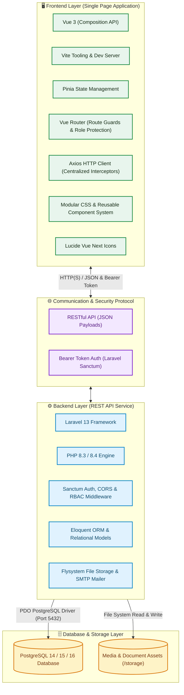

# Dokumentasi Teknis Sistem GrowHub
**Enterprise Knowledge Sharing & Gamification Platform**

---

## Daftar Isi
1. [Point 1: Deskripsi Sistem](#point-1-deskripsi-sistem)
2. [Point 2: Fitur - Fitur Sistem](#point-2-fitur---fitur-sistem)
3. [Point 3: Theme, Style Teks, dan Color Palette](#point-3-theme-style-teks-dan-color-palette)
4. [Point 4: Tech Stack](#point-4-tech-stack)
5. [Point 5: Database Schema (ERD & Spesifikasi Tabel)](#point-5-database-schema)
6. [Point 6: Step by Step Menjalankan Sistem / Deployment (Windows Server & Linux Server)](#point-6-step-by-step-menjalankan-sistem--deployment)

---

## Point 1: Deskripsi Sistem

### 1.1 Ringkasan
**GrowHub** adalah platform enterprise modern berbasis web yang dirancang khusus guna memfasilitasi pertukaran pengetahuan (*knowledge sharing*), kolaborasi operasional, pelatihan mandiri (*micro-learning*), dan keterlibatan karyawan (*employee engagement*) melalui integrasi mekanika gamifikasi (*points, streaks, levels, dan leaderboards*).

Platform ini mengusung tagline:
> **"Grow Together, Share Knowledge."**


---

## Point 2: Fitur - Fitur Sistem

Sistem GrowHub memiliki modul fungsional terintegrasi yang terbagi berdasarkan hak akses pengguna:

### 2.1 Manajemen Akses, Keamanan & Autentikasi
1. **Login Berbasis NIP**:
   - Username menggunakan 9–10 digit Nomor Induk Pegawai (NIP).
   - Password awal diset sama dengan NIP untuk kemudahan onboarding frontline.
2. **Mandatory First-Time Password Change & Email OTP (`must_change_password`)**:
   - User yang baru login pertama kali (atau akun yang baru direset oleh Admin) otomatis diarahkan ke alur 2 tahap: **(1) Verifikasi OTP Email 6 digit** (`POST /api/auth/change-password/send-otp` & `verify-otp`) ke alamat email terdaftar (berlaku 1 menit, cooldown kirim ulang 60 detik, maksimal 5 percobaan salah) dan **(2) Pembuatan Password Baru** minimal 8 karakter yang tidak boleh sama dengan NIP default.
   - User diblokir dari akses halaman dashboard sebelum menyelesaikan verifikasi OTP dan pengaturan password baru.
3. **Kebijakan Reset Password Terpusat & OTP Profil**:
   - Karyawan reguler tidak dapat melakukan reset password mandiri di halaman profil maupun di layar login untuk mencegah penyalahgunaan akun bersama.
   - Reset password hanya dapat dipicu oleh Administrator melalui menu User Management (mengembalikan ke NIP default dan memicu status `must_change_password`). Khusus Administrator (atau akun dalam status wajib ganti password), tersedia pembaruan password di halaman Profil yang tetap diproteksi verifikasi **OTP Email** (`POST /api/profile/password/send-otp`, `verify-otp`, `PUT /api/profile/password`).
4. **Post-Login Ethics Notice Modal (`EthicsNoticeModal`)**:
   - Setiap kali login berhasil, frontend memunculkan modal *Pemberitahuan Etika Komunikasi* yang mengambil daftar kebijakan aktif dari `GET /api/ethics-policies` agar karyawan memahami aturan berbagi dan konsekuensi pengurangan poin sebelum beraktivitas.
5. **Role-Based Access Control (RBAC)**:
   - **Employee (Karyawan)**: Mengunggah konten, berdiskusi, belajar di Learning Center, memantau riwayat baca (*History Content*), dan melihat ranking.
   - **Reviewer**: Memvalidasi, menyetujui (*approve*), atau menolak (*reject*) antrean konten dengan catatan evaluasi.
   - **Administrator**: Hak akses penuh mencakup kelola akun user, reset password, hapus akun, moderasi komentar pelanggaran etika, serta konfigurasi dinamis *Point Settings*, *Level Settings*, *Rank Settings*, dan *Policy & Validation Config*.

### 2.2 Knowledge Feed, History Content & Pengalaman UI
1. **Multikategori Konten**:
   - *Best Practice*, *Tips & Trick*, *Lesson Learned*, *Innovation & Ideas*, *Document/SOP*, *Success Story*, *Group Discussion*, dan *Video & Photo Sharing*.
2. **Editor Konten Interaktif**:
   - Pemilihan kategori dan komunitas tujuan.
   - Multi-upload lampiran: Gambar (JPG/PNG/GIF/WEBP), Video singkat (MP4/MOV/WEBM/AVI), dan Dokumen SOP (PDF/DOC/DOCX/XLS/XLSX/PPT/PPTX/TXT/CSV) hingga 50 MB per file (maks. 10 file).
   - Tagging topik untuk pengelompokan yang fleksibel.
3. **Interaksi Sosial Karyawan & Moderasi Komentar**:
   - **Like & Save**: Memberikan apresiasi atau menyimpan materi ke koleksi pribadi (*Saved Knowledge*).
   - **Threaded Comments & Admin Moderation**: Diskusi bertingkat antar-karyawan per materi. Saat Admin menghapus komentar karyawan lain karena melanggar aturan, Admin wajib memilih alasan pelanggaran (`ethics_policy_id`), dan sistem otomatis mengurangi poin pelanggar serta mengirim notifikasi in-app dan email peringatan (`CommentViolationMail`).
   - **Share Modal**: Berbagi tautan materi langsung ke WhatsApp Web, Email, Slack/Teams, atau salin tautan link.
4. **History Content & Recently Viewed (`ContentView`)**:
   - Setiap kali karyawan membuka konten berstatus `published`, backend mencatat/memperbarui timestamp kunjungan di tabel `content_views` (unik per `[user_id, content_id]`).
   - Halaman **Home** menampilkan maksimal **3 konten terakhir** pada widget *Recently Viewed* lengkap dengan tautan **View More** menuju halaman **History Content** (`/history`, endpoint `GET /api/my/history`) yang mendukung pencarian dan paginasi.
5. **Konsistensi Layout (*Loading Skeleton*) & Penanganan Error HTTP Terpusat**:
   - Seluruh halaman utama dan widget (*HomeView*, *DashboardView*, *FeedView*, *HistoryContentView*, *Communities*, *Learning*, *ReviewPortal*, *Admin Consoles*) menerapkan kerangka muat (*loading skeleton*) dengan ukuran terukur agar mencegah pergeseran tata letak (*layout shift*).
   - Penanganan error jaringan dan HTTP dipusatkan pada `frontend/src/utils/httpError.js` dan interceptor Axios (`frontend/src/api/client.js`) untuk membedakan status HTTP standar (`400`, `401`, `403`, `404`, `405`, `408`, `413`, `419`, `422`, `429`, `500`, `502`, `503`, `504`) dengan kondisi jaringan tidak terhubung (*network error*).

### 2.3 Reviewer Validation Portal
1. **Antrean Validasi (Validation Queue)**:
   - Menampilkan konten bersatus *Pending Review* secara kronologis.
2. **Approval Workflow**:
   - Reviewer dapat memeriksa preview teks, video, atau lampiran dokumen.
   - Tombol **Approve**: Menerbitkan konten ke Knowledge Feed publik dan secara otomatis memberikan poin reward kontribusi kepada penulis.
   - Tombol **Reject**: Mengembalikan konten dengan modal catatan evaluasi (*Reviewer Feedback Note*) agar penulis mengetahui bagian yang harus direvisi.

### 2.4 Communities Hub
1. **Komunitas Operasional & Peminatan**:
   - Wadah forum khusus departemen (misal: *Store Operations Squad*, *Visual Merchandising*, *Customer Care Champions*).
2. **Join / Leave Community**:
   - Karyawan bebas bergabung ke komunitas yang relevan dengan tugas cabangnya.
   - Feed khusus yang menampilkan materi eksklusif anggota komunitas.

### 2.5 Learning Center (Micro-Learning)
1. **Modul Pelatihan**:
   - Modul pembelajaran mandiri berisi teks terstruktur, panduan langkah operasional, video tutorial tersemat, dan estimasi menit belajar.
2. **Course Completion & Reward**:
   - Tombol *Complete Course* menandai penyelesaian materi dan secara instan mentransfer poin pembelajaran ke akun karyawan.
   - Indikator centang status *Completed* untuk modul yang telah tuntas.

### 2.6 Gamification Engine & Leaderboards
1. **Sistem Poin Transaksional & Kontrol Dinamis (Configurable Rules)**:
   - Nilai default sistem: Daily login (+2 poin), submit konten (+5 poin), konten disetujui reviewer (+25 poin), membaca konten (+1 poin), menerima like (+2 poin), memberi komentar (+1 poin), menerima komentar (+3 poin), share konten (+1 poin), menyelesaikan modul kursus (+15 poin).
   - **Pengaturan & Saklar On/Off Administrator**: Administrator memiliki hak penuh untuk menentukan besaran perolehan poin per aksi, mengatur kuota batas harian (*daily caps*), dan mengaktifkan/menonaktifkan (*toggle active*) sistem poin kapan saja untuk tindakan tertentu (misal: hanya mengaktifkan poin untuk posting & membaca artikel, atau hanya untuk penyelesaian modul pelatihan). Tindakan yang dinonaktifkan secara otomatis menghasilkan 0 poin.
2. **Daily Streak Tracker**:
   - Menghitung keaktifan beruntun hari demi hari.
   - Bonus ekstra poin setiap kelipatan 7 hari berturut-turut (+15 poin). Streak reset ke 1 jika absen satu hari.
3. **8-Tier Level Progression**:
   - Lv. 1 *Seedling* (0 Pts)
   - Lv. 2 *Sprout* (100 Pts)
   - Lv. 3 *Sapling* (250 Pts)
   - Lv. 4 *Grower* (500 Pts)
   - Lv. 5 *Cultivator* (900 Pts)
   - Lv. 6 *Harvester* (1400 Pts)
   - Lv. 7 *Mentor* (2000 Pts)
   - Lv. 8 *Evergreen* (3000+ Pts)
4. **Leaderboard Interaktif**:
   - Peringkat karyawan berdasarkan total poin.
   - Filter waktu: *All-Time*, *This Month*, *This Week*.
   - Filter departemen untuk melihat juara internal per divisi.
5. **Daftar Berkas & Modul Teknis (Technical Architecture & File Mapping)**:
   - **Controllers**:
     - `backend/app/Http/Controllers/Api/DashboardController.php`: Endpoint `GET /api/leaderboard` (filter periode *all/month/week*, filter divisi/departemen, kalkulasi rank pribadi), `GET /api/dashboard` (agregasi poin, daily chart, activity heatmap, badge capaian, riwayat mutasi poin), dan `GET /api/home` (widget *top weekly leaders*).
     - `backend/app/Http/Controllers/Api/AdminPointRuleController.php`: Endpoint `GET /api/admin/point-rules` (daftar aturan & statistik), `PUT /api/admin/point-rules/{id}` (update nilai poin & daily cap), `POST /api/admin/point-rules/{id}/toggle` (saklar on/off aktivasi), `PUT /api/admin/point-rules/batch` (simpan massal), dan `POST /api/admin/point-rules/reset-defaults` (kembalikan ke default).
     - `backend/app/Http/Controllers/Api/AuthController.php`: Pemicu penambahan poin harian & pembaruan streak via `recordActivity()` saat login pertama setiap hari.
     - `backend/app/Http/Controllers/Api/ContentController.php`: Pemicu penambahan poin `content_submitted` (+5 poin) saat unggah konten dan `content_viewed` (+1 poin) saat membaca postingan rekan kerja.
     - `backend/app/Http/Controllers/Api/ReviewController.php`: Pemicu penambahan poin `content_published` (+25 poin) ke kreator konten dan `review_done` (+3 poin) ke reviewer saat konten divalidasi dan disetujui.
     - `backend/app/Http/Controllers/Api/EngagementController.php`: Pemicu transaksi poin interaksi sosial: `like_received` (+2 poin), `save_received` (+2 poin), `share_given` (+1 poin), `share_received` (+2 poin), `comment_given` (+1 poin), dan `comment_received` (+3 poin).
     - `backend/app/Http/Controllers/Api/CourseController.php`: Pemicu pemberian poin reward `course_completed` (+15 poin) saat materi pembelajaran tuntas dipelajari.
     - `backend/app/Http/Controllers/Api/AdminUserController.php`: Modul konsol admin untuk penyesuaian atau penambahan bonus poin manual kepada karyawan.
     - `backend/app/Http/Controllers/Api/AdminRankSettingController.php`: Modul konsol admin untuk mengonfigurasi batas kuota peringkat teratas Leaderboard, widget Beranda, dan jadwal/eksekusi reset Leaderboard (`GET /api/admin/rank-settings`, `PUT /api/admin/rank-settings`, `POST /api/admin/rank-settings/reset-defaults`, `manual-reset`, `clear-manual-reset`).
     - `backend/app/Http/Controllers/Api/AdminLevelRuleController.php`: Modul konsol admin untuk manajemen tingkatan level dinamis (`GET/POST /api/admin/level-rules`, `PUT/DELETE /{levelRule}`, `POST /{levelRule}/toggle`, `PUT /batch`, `POST /reset-defaults`).
     - `backend/app/Http/Controllers/Api/AdminPolicyConfigController.php`: Modul konsol admin untuk kebijakan etika komunikasi & daftar pelanggaran (`GET/POST /api/admin/policy-configs`, `PUT /batch`, `PUT/DELETE /{ethicsPolicy}`), serta endpoint publik terautentikasi `GET /api/ethics-policies`.
     - `backend/app/Http/Controllers/Api/AdminHelperContactController.php`: Modul konsol admin untuk kelola kontak helper & saluran bantuan support (`GET/POST/PUT/DELETE /api/admin/helper-contacts`), serta endpoint publik `GET /api/support/helpers`.
     - `backend/app/Http/Controllers/Api/AdminMailSettingController.php`: Modul konsol admin untuk konfigurasi SMTP & email pengirim (`GET/PUT /api/admin/mail-settings`, `POST /test`), sinkronisasi database `mail_settings`, runtime config, dan file `.env`.
     - `backend/app/Http/Controllers/Api/ProfileController.php`: Pengelolaan profil diri, unggah avatar (maks. 3 MB), serta alur ganti password ber-OTP untuk Admin/wajib ganti password.
   - **Services, Mail & Middleware**:
     - `backend/app/Services/GamificationService.php`: Mesin (*engine*) utama transaksi poin (`award()` & `deduct()`), evaluasi aturan dinamis `PointRule` dari database (memeriksa status aktif dan batas harian `daily_caps`), deteksi kenaikan tingkat (*level-up*) dengan pembuatan notifikasi otomatis, dan kalkulator keaktifan beruntun (*streak tracking* via `recordActivity()`).
     - `backend/app/Services/LevelService.php`: Logika pemetaan tier level dinamis berbasis tabel `level_rules` (fallback ke `config/gamification.php`), penentuan target level berikutnya, sisa poin menuju kenaikan level, dan persentase progress bar.
     - `backend/app/Services/PasswordOtpService.php`: Pengelolaan pembuatan OTP 6 digit (`EXPIRES_MINUTES = 1`, `RESEND_COOLDOWN_SECONDS = 60`, `MAX_ATTEMPTS = 5`), validasi kode, dan penerbitan `otp_verification_token` sebelum perubahan password.
     - `backend/app/Mail/PasswordOtpMail.php`, `backend/app/Mail/CommentViolationMail.php`, & `backend/app/Mail/TestSmtpMail.php`: Pengiriman email OTP verifikasi password, notifikasi pelanggaran etika komentar, serta email pengujian verifikasi koneksi SMTP.
     - `backend/app/Http/Middleware/EnsureAdmin.php`: Middleware otorisasi khusus memastikan hanya role Administrator yang dapat mengubah aturan poin, level, ranking, kebijakan etika, kontak helper, pengaturan SMTP, dan user.
     - `backend/app/Http/Middleware/TrackActivity.php`: Middleware HTTP untuk memantau aktivitas request pengguna terautentikasi dan memperbarui streak harian secara pasif tanpa perlu login ulang.
     - `backend/config/gamification.php` & `backend/config/cors.php`: Konfigurasi fallback gamifikasi dan kebijakan CORS lintas origin (`CORS_ALLOWED_ORIGINS`).
   - **Models**:
     - `backend/app/Models/PointRule.php`: Model aturan dinamis sistem poin (`action`, `name`, `description`, `category`, `points`, `daily_cap`, `is_active`, `sort_order`).
     - `backend/app/Models/LevelRule.php`: Model tingkatan level dinamis (`level`, `name`, `min_points`, `description`, `badge_icon`, `badge_color`, `is_active`).
     - `backend/app/Models/User.php`: Menyimpan data keaktifan (`points`, `current_streak`, `longest_streak`, `last_activity_date`), method `isAdmin()`, relasi ledger `pointTransactions()`, dan dynamic accessor `level_info`.
     - `backend/app/Models/PointTransaction.php`: Model pencatatan buku besar (*ledger*) riwayat transaksi perolehan maupun pengurangan poin dengan relasi polimorfik ke objek sumber (`reference_type`, `reference_id`).
     - `backend/app/Models/AppNotification.php`: Model notifikasi in-app otomatis saat pengguna naik level (*level_up*), mencapai bonus streak 7 hari (*streak*), atau menerima sanksi `policy_violation`.
     - `backend/app/Models/RankSetting.php`: Model penyimpanan konfigurasi batas kuota ranking & jadwal reset (`leaderboard_limit`, `home_widget_limit`, `show_podium`, `show_my_rank_outside`, `reset_frequency`, `last_reset_at`).
     - `backend/app/Models/EthicsPolicy.php`: Model daftar kebijakan etika komunikasi dan bobot pengurangan poin (`title`, `description`, `point_deduction`, `severity`, `is_active`, `sort_order`).
     - `backend/app/Models/PasswordChangeOtp.php`: Model penyimpanan OTP perubahan password yang di-hash (`purpose`, `email`, `code_hash`, `attempts`, `expires_at`, `verified_at`, `verification_token_hash`, `used_at`).
     - `backend/app/Models/ContentView.php`: Model pelacakan konten terbit yang dibuka per user (`user_id`, `content_id`, `viewed_at`).
     - `backend/app/Models/HelperContact.php`: Model daftar kontak helper saluran bantuan pengguna (`name`, `role_or_title`, `channel`, `contact_value`, `available_hours`, `description`, `is_active`, `sort_order`).
     - `backend/app/Models/MailSetting.php`: Model konfigurasi server SMTP & pengirim email (`mail_mailer`, `mail_scheme`, `mail_host`, `mail_port`, `mail_username`, `mail_password`, `mail_from_address`, `mail_from_name`, `updated_by`).
   - **Migrations**:
     - `backend/database/migrations/0001_01_01_000000_create_users_table.php`: Skema kolom user dan kolom gamifikasi (`points`, `current_streak`, `longest_streak`, `last_activity_date`, serta indeks pada `points`).
     - `backend/database/migrations/2026_10_27_000001_create_growhub_tables.php`: Skema inti GrowHub termasuk `contents`, `content_media`, `comments`, `point_transactions` lengkap dengan indeks performa komposit `[user_id, created_at]` dan `[action, created_at]`.
     - `backend/database/migrations/2026_10_28_080000_create_point_rules_table.php`: Skema tabel dinamis `point_rules` beserta seed 12 aturan awal gamifikasi.
     - `backend/database/migrations/2026_11_02_080000_create_level_rules_table.php`: Skema tabel dinamis `level_rules` beserta seed 8 level bawaan.
     - `backend/database/migrations/2026_11_03_080000_create_rank_settings_table.php` & `2026_11_03_090000_add_reset_schedule_to_rank_settings_table.php`: Skema `rank_settings` beserta jadwal reset (`reset_frequency`, `last_reset_at`).
     - `backend/database/migrations/2026_11_11_120000_create_password_change_otps_table.php`: Skema tabel `password_change_otps`.
     - `backend/database/migrations/2026_11_11_140000_create_ethics_policies_table.php`: Skema tabel `ethics_policies` beserta 5 kebijakan bawaan sistem.
     - `backend/database/migrations/2026_11_12_092000_create_content_views_table.php`: Skema tabel `content_views` dengan unique composite `['user_id', 'content_id']`.
     - `backend/database/migrations/2026_11_24_174000_create_helper_contacts_table.php`: Skema tabel `helper_contacts` beserta seed kontak IT Helpdesk, HC Support, dan Hotline.
     - `backend/database/migrations/2026_11_24_175000_create_mail_settings_table.php`: Skema tabel `mail_settings` untuk persistensi konfigurasi SMTP server.
   - **UI Views, Components, Utilities & IIS Configs**:
     - `frontend/src/views/AdminPointRulesView.vue`: Halaman konsol Administrator untuk mengatur bobot poin per aksi, toggle saklar aktif/nonaktif real-time, konfigurasi batasan harian, dan fitur reset default.
     - `frontend/src/views/level-rules/AdminLevelRulesView.vue`: Halaman konsol Administrator untuk manajemen jenjang level dinamis (*Level Settings*), kustomisasi ikon & warna badge, serta roadmap level.
     - `frontend/src/views/rank-settings/AdminRankSettingsView.vue`: Halaman konsol Administrator untuk mengonfigurasi batas kuota Top Leaderboard, widget Beranda, jadwal reset, saklar podium/ranking luar, dan live preview simulation.
     - `frontend/src/views/policy-config/AdminPolicyConfigView.vue`: Halaman konsol Administrator untuk mengelola daftar aturan etika komunikasi, pengurangan poin sanksi, dan pratinjau pop-up etika.
     - `frontend/src/views/admin/AdminHelperContactsView.vue`: Halaman konsol Administrator untuk mengelola kontak helper bantuan teknis dan support.
     - `frontend/src/views/admin/AdminMailSettingView.vue`: Halaman konsol Administrator untuk konfigurasi server SMTP, port, kredensial, dan live test pengiriman email.
     - `frontend/src/views/HistoryContentView.vue`: Halaman daftar lengkap konten yang pernah dibuka oleh user (*History Content*).
     - `frontend/src/views/LeaderboardView.vue` & `frontend/src/views/DashboardView.vue` & `frontend/src/views/HomeView.vue`: Halaman klasemen, dasbor pribadi, dan beranda (termasuk widget *Recently Viewed* 3 konten terakhir, *Top This Week*, *Recommended Modules*, dan *Knowledge Categories* dengan tinggi konsisten & loading skeleton).
     - `frontend/src/components/common/EthicsNoticeModal.vue` & `ContentCardSkeleton.vue`: Komponen pop-up Pemberitahuan Etika Komunikasi pasca-login dan komponen kerangka muat seragam.
     - `frontend/src/utils/httpError.js` & `frontend/src/api/client.js`: Utilitas standarisasi pesan error respons HTTP (`400`–`504`) dan interceptor Axios terpusat.
     - `frontend/public/web.config` & `backend/public/web.config`: Konfigurasi URL Rewrite dan IIS FastCGI (dukungan verb `GET,HEAD,POST,PUT,PATCH,DELETE,OPTIONS`) untuk deployment Windows IIS.

### 2.7 Admin Console (User Management)
1. **Direktori Karyawan Lengkap**:
   - Pencarian instan (Nama, NIP, Email, Departemen, Posisi).
   - Filter dropdown role dan departemen dengan server-side pagination (10 per halaman).
2. **Onboarding Karyawan Baru**:
   - Pendaftaran karyawan baru dengan opsi bonus poin selamat datang (*onboarding bonus points*).
3. **Edit Akun & Reset Password**:
   - Pengubahan nama, role, status aktif/nonaktif, lokasi cabang, departemen, dan poin.
   - Tombol 1-klik **Reset Password ke NIP** dengan status wajib ganti password di login berikutnya.
4. **Penghapusan Akun Aman**:
   - Modal konfirmasi hapus permanen dengan proteksi anti-hapus akun sendiri (*cannot delete self*).
5. **Manajemen Aturan Sistem Poin & Saklar Aktivasi (Point Rules & Toggles)**:
   - Panel kontrol interaktif bagi Administrator untuk mengelola skema gamifikasi perusahaan secara fleksibel tanpa menyentuh kode program.
   - **Kustomisasi Nilai Poin**: Mengubah besaran poin yang diperoleh untuk setiap tindakan (*action*), baik melalui input angka langsung maupun tombol stepper (+/-).
   - **Saklar Aktivasi Mandiri (*Instant On/Off Toggle*)**: Hak menyalakan atau mematikan sistem reward poin untuk aksi tertentu kapan saja (misal: hari ini hanya mengaktifkan poin untuk posting & membaca artikel atau menyelesaikan modul kursus saja; aksi yang dinonaktifkan akan otomatis bernilai 0 poin).
   - **Pengendalian Kuota Harian (*Daily Caps*)**: Menentukan batas maksimal frekuensi perolehan poin per hari untuk mencegah spamming (misal: batas 10 komentar, 10 share, atau 10 baca artikel per hari).
   - **Pembaruan Massal (*Batch Save*)**: Tombol untuk menyimpan seluruh penyesuaian aturan sekaligus.
   - **Reset ke Default Bawaan**: Fasilitas 1-klik untuk mengembalikan seluruh skema poin dan batasan harian ke konfigurasi default sistem.
6. **Manajemen Batas Kuota Peringkat & Siklus Reset Leaderboard (Rank Settings)**:
   - Panel kontrol interaktif bagi Administrator (`/admin/rank-settings`) untuk:
     - **Kebijakan Siklus Reset Leaderboard (`reset_frequency`)**: Menentukan kapan skor leaderboard direset otomatis: `never` (tanpa reset / sepanjang masa), `weekly` (mingguan / tiap Senin), `monthly` (bulanan / tiap tanggal 1), `quarterly` (triwulan / 3 bulan), atau `yearly` (tahunan / tiap 1 Januari).
     - **Aksi Reset Instan Sekarang (*Manual Reset Now*)**: Endpoint `POST /api/admin/rank-settings/manual-reset` dan `POST /api/admin/rank-settings/clear-manual-reset` untuk memulai musim kompetisi baru seketika atau membatalkan status reset manual.
     - **Batas Kuota Peringkat Teratas (`leaderboard_limit`)**: Membatasi Top X karyawan yang diambil dari basis data dan ditampilkan di Leaderboard (preset: Top 10, Top 20, Top 25, Top 50, Top 100, atau input kustom 3–500).
     - **Batas Kuota Widget Beranda (`home_widget_limit`)**: Penyesuaian batas kuota widget mingguan Beranda (Top 3, Top 5, Top 10).
     - **Saklar Panggung Podium Top 3 (`show_podium`)**: Saklar On/Off panggung visual podium Top 3 (Emas, Perak, Perunggu).
     - **Saklar Transparansi Posisi Luar Kuota (`show_my_rank_outside`)**: Menampilkan nomor peringkat nyata karyawan jika berada di luar batas kuota Top X.
     - **Live Interactive Simulation Preview**: Visualisasi langsung mockup podium, tabel, dan kartu sticky rank secara real-time.
7. **Manajemen Jenjang Level Dinamis (Level Settings)**:
   - Panel kontrol Administrator (`/admin/level-rules`) untuk mengelola nama level, ambang batas `min_points`, ikon lencana, warna badge, toggle aktif/nonaktif, tambah tier baru, edit massal (*batch save*), dan reset ke 8 level default.
8. **Manajemen Kebijakan Etika & Moderasi Komentar (`Policy and Validation Config`)**:
   - Panel kontrol Administrator (`/admin/policy-config`) untuk menambah, mengedit massal (*batch update*), mengurutkan (`sort_order`), atau menghapus aturan etika komunikasi (`title`, `description`, `point_deduction`, `severity`, minimal 1 aturan tersisa).
   - Besaran punishment pengurangan poin bersifat **dinamis per jenis pelanggaran** (tidak statis -1 Pts untuk semua), misalnya:
     - Pelanggaran Berat (*High Severity*, misal: kebocoran data rahasia perusahaan/pelanggan, ujaran SARA & kebencian): sanksi default **-5 Pts**.
     - Pelanggaran Sedang (*Medium Severity*, misal: spamming/manipulasi poin, promosi pribadi di luar pekerjaan): sanksi default **-3 Pts s/d -2 Pts**.
     - Pelanggaran Ringan (*Low Severity*, misal: informasi menyesatkan/dokumentasi tidak asli): sanksi default **-1 Pts**.
     - Administrator dapat mengubah angka pengurangan poin (`point_deduction`) secara fleksibel dari 1 hingga 10.000 Pts sesuai kebijakan perusahaan.
   - Tersedia pratinjau langsung pop-up **Pemberitahuan Etika Komunikasi** (lengkap dengan label sanksi poin per item) serta integrasi wajib pilih alasan pelanggaran (`ethics_policy_id`) saat Admin menghapus komentar pengguna lain di detail konten.

### 2.8 Profil Karyawan, Tiket Bantuan & Kontak Helper
1. **Portofolio Karyawan**:
   - Ringkasan statistik pribadi: jumlah karya terbit, total like terkumpul, total view, komunitas yang diikuti, dan materi kursus yang telah diselesaikan.
2. **Help & Support Ticket & Kontak Helper**:
   - **Layanan Kontak Helper Karyawan**: Menampilkan daftar kontak helper resmi (WhatsApp, Email, Telepon Hotline, Telegram) lengkap dengan jam operasional, nama PIC, dan tombol aksi langsung untuk bantuan login, lupa password, aktivasi akun, dan kendala teknis.
   - **Tanya Jawab Seputar Sistem (FAQ)**: Panduan ringkas seputar akun, konten, dan gamifikasi.
   - **Pengiriman Tiket Bantuan**: Pengiriman tiket bantuan langsung ke tim Admin HC/IT dengan pelacakan status (*Open*, *In Progress*, *Resolved*).
3. **Manajemen Kontak Helper (Admin Console - `/admin/helper-contacts`)**:
   - Administrator dapat menambah, mengedit, mengaktifkan/menonaktifkan, mengurutkan, menghapus, atau mereset daftar kontak helper yang tampil di Halaman Login dan Halaman Help & Support.
4. **Real-time In-App Notifications**:
   - Pemberitahuan otomatis ketika konten disetujui, ditolak, menerima interaksi like/komentar, atau saat mendapatkan bonus poin streak.

---

## Point 3: Theme, Style Teks, dan Color Palette

Sistem GrowHub mengusung prinsip desain **Clean Organic Modern Enterprise**: memadukan nuansa kesegaran hijau alami dengan ketegasan tampilan korporat yang profesional, bersih, dan mudah dibaca pada perangkat desktop maupun tablet store.

### 3.1 Color Palette (Palet Warna Sistem)

| Peran Warna | Nama Token CSS | Kode HEX | Preview / Kegunaan |
| :--- | :--- | :--- | :--- |
| **Primary Brand** | `--primary` | `#1e8c45` | Warna utama logo, tombol primer, aksen aktif, indikator progres |
| **Primary Dark** | `--primary-dark` / `--dark` | `#142c14` | Latar belakang hero bar, heading utama, warna teks judul |
| **Primary Light** | `--green-light` | `#7dcb9b` | Teks highlight sekunder pada latar gelap, gradasi tombol |
| **Primary Subtle** | `--green-50` | `#e8f5ed` | Background chip, ikon aktif, sorotan kartu terpilih |
| **Page Canvas** | `--bg` | `#f8faf8` | Background keseluruhan halaman aplikasi |
| **Card Surface** | `--surface` | `#ffffff` | Background kartu tabel, formulir, modal popup |
| **Subtle Area** | `--bg-subtle` | `#fafbfa` | Background header tabel, input readonly, pill card |
| **Border Line** | `--border` | `#e5eae6` | Garis pembatas kartu, separator divider, input stroke |
| **Text Primary** | `--text` / `--text-1` | `#142c14` | Teks konten utama, paragraf penting, label tebal |
| **Text Secondary** | `--text-2` | `#526655` | Teks subjudul, petunjuk form, label sekunder |
| **Text Muted** | `--text-3` | `#7d9180` | Tanggal, teks hint kecil, ikon non-aktif |
| **Gamification: Points** | `--amber` | `#f59e0b` / `#b45309` | Ikon bintang poin, badge ranking, token gamifikasi |
| **Gamification: Streak** | `--orange` | `#f97316` / `#ea580c` | Ikon api streak harian, badge konsistensi aktif |
| **Danger / Alert** | `--red` | `#dc2626` / `#b91c1c` | Tombol hapus, pesan error, penolakan reviewer |
| **Info / Module** | `--blue` | `#2563eb` | Badge kursus modul, info panduan |
| **Innovation / Community** | `--purple` | `#8b5cf6` | Kategori ide inovasi, badge tim komunitas |

#### Gradient Khusus Sistem:
- **Hero / Card Dark**: `linear-gradient(135deg, #142c14 0%, #1e8c45 60%, #2ba858 100%)`
- **Skeleton Shimmer**: `linear-gradient(90deg, #f0f4f1 25%, #e6ede8 37%, #f0f4f1 63%)`

---

### 3.2 Typography & Style Teks
Sistem menggunakan font Google Fonts modern: **Plus Jakarta Sans** (dengan fallback `system-ui, -apple-system, Segoe UI, sans-serif`).

| Tipe Teks | Ukuran (Font Size) | Bobot (Weight) | Karakteristik / Line Height | Contoh Penggunaan |
| :--- | :--- | :--- | :--- | :--- |
| **Hero Title** | `32px` | `800` (Extra Bold) | Line-height `1.2`, letter-spacing `-0.02em` | Judul hero pada halaman Login |
| **Page Title** | `26px` | `800` (Extra Bold) | Line-height `1.25`, letter-spacing `-0.02em` | Judul halaman atas (*User Management*, *Feed*) |
| **Card Title / Heading 2** | `20px` | `800` (Extra Bold) | Line-height `1.3` | Judul modal popup, judul section kartu |
| **Section Title / Heading 3**| `16px` | `700` (Bold) | Line-height `1.35` | Judul konten feed, judul modul pembelajaran |
| **Body Standard** | `14px` | `400` / `500` | Line-height `1.55` | Paragraf bacaan, teks form input, isi komentar |
| **Table Header** | `12px` | `700` (Bold) | Uppercase, letter-spacing `0.05em` | Judul kolom tabel pengguna (*EMPLOYEE*, *ROLE*) |
| **Caption & Meta** | `12px` | `500` (Medium) | Line-height `1.4`, warna `--text-2` / `--text-3` | Tanggal posting, counter likes, subtitle |
| **Badges & Role Pills** | `10.5px` – `11px` | `700` (Bold) | Uppercase / tracking `0.04em`, border-radius `999px` | Badge level, role *Admin*, *Employee*, *Reviewer* |

---

### 3.3 Micro-Animations & Elevation
- **Card Shadows**:
  - Standar: `0 8px 24px rgba(20, 44, 20, 0.08)`
  - Elevated Modal: `0 24px 48px rgba(0, 0, 0, 0.22)`
  - Green Hover: `0 10px 24px rgba(30, 140, 69, 0.28)`
- **Border Radius**:
  - Button & Input: `8px` – `10px` (`--radius`)
  - Standard Card: `14px` – `16px` (`--radius-lg`)
  - Modal Popup: `18px` – `20px` (`--radius-xl`)
- **Keyframe Animations**: `fadeIn`, `fadeUp` (slide up 10px), `popIn` (scale 0.94 to 1), dan `spin` (infinite linear rotate untuk loading indicator).

---

## Point 4: Tech Stack

GrowHub dibangun menggunakan arsitektur modern **Decoupled Client-Server (SPA + RESTful API)**:



### 4.1 Tabel Detail Komponen Teknologi

| Lapisan (Layer) | Teknologi | Versi | Alasan Pemilihan & Fungsi |
| :--- | :--- | :--- | :--- |
| **Frontend Framework** | **Vue.js 3** | `^3.5.x` | Menggunakan *Composition API* dengan sintaks `<script setup>` yang ringkas, cepat, dan reaktif. |
| **Frontend Tooling** | **Vite** | `^8.x` | *Build tool* dan *dev server* berbasis Vite/Rollup yang menghasilkan bundle ringan, HMR instan, dan proxy API `/api` & `/storage` selama development. |
| **State Management** | **Pinia** | `^4.x` (`4.1+`) | Pengelolaan state global untuk autentikasi pengguna (`authStore`), modal pemberitahuan etika, dan notifikasi toast (`toastStore`). |
| **Client Routing** | **Vue Router** | `^4.x` (`4.6+`) | Navigasi SPA dengan *navigation guards* untuk proteksi hak akses role (*guest*, *auth*, *reviewer*, *admin*) dan deteksi `must_change_password`. |
| **HTTP Client** | **Axios + `httpError.js`** | `^1.20.x` | Pengiriman request HTTP terpusat dengan interceptor Bearer Token otomatis serta pemetaan standar kode respons HTTP (`400`–`504`) dan galat jaringan. |
| **Icon Set** | **Lucide Vue Next**| `^1.0.x` | Set ikon SVG modern yang konsisten, bersih, dan hemat bobot bundle. |
| **Styling Engine** | **Vanilla CSS 3** | Standard | CSS kustom murni menggunakan variabel token (`var(--primary)`), flexbox, grid, loading skeleton, dan glassmorphism. |
| **Backend Framework** | **Laravel** | `13.x` (`^13.17`) | Framework PHP enterprise modern dengan Eloquent ORM, validasi terstruktur, rate limiter, CORS middleware, dan Laravel Mail (OTP & notifikasi). |
| **Runtime Bahasa** | **PHP** | `8.3+ / 8.4` (`^8.3 \|\| ^8.4`) | Mendukung runtime PHP 8.3 maupun PHP 8.4 sesuai `composer.json` dengan performa OPcache/JIT optimal dan ekstensi PostgreSQL modern. |
| **Autentikasi API** | **Laravel Sanctum**| `^4.x` | Token bearer API ringan (*personal access tokens*) untuk SPA tanpa kompleksitas OAuth server yang berlebihan. |
| **Database Server** | **PostgreSQL** | `14+` | RDBMS tangguh kelas enterprise dengan kemampuan indexing JSON, performa transaksi tinggi, dan konkurensi handal. |
| **Media & Storage** | **Flysystem / Public Disk** | Laravel Core | Pengelolaan penyimpanan berkas foto profil, lampiran dokumen, gambar materi, dan video secara aman. |

---

## Point 5: Database Schema

### 5.1 Diagram Relasi Entitas (Entity-Relationship Diagram / ERD)

```mermaid
erDiagram
    users ||--o{ contents : "menulis"
    users ||--o{ point_transactions : "menerima poin"
    users ||--o{ comments : "memberikan komentar"
    users ||--o{ likes : "menyukai"
    users ||--o{ saves : "menyimpan"
    users ||--o{ content_views : "membuka konten"
    users ||--o{ password_change_otps : "memverifikasi OTP"
    users ||--o{ shares : "membagikan"
    users ||--o{ community_members : "bergabung"
    users ||--o{ course_completions : "menyelesaikan kursus"
    users ||--o{ app_notifications : "menerima notifikasi"
    users ||--o{ support_tickets : "membuat tiket"

    categories ||--o{ contents : "mengelompokkan"
    communities ||--o{ contents : "memiliki feed"
    communities ||--o{ community_members : "memiliki anggota"

    contents ||--o{ content_media : "memiliki lampiran berkas"
    contents ||--o{ comments : "memiliki komentar"
    contents ||--o{ likes : "menerima like"
    contents ||--o{ saves : "disimpan"
    contents ||--o{ content_views : "dicatat riwayat baca"
    contents ||--o{ shares : "dibagikan"

    courses ||--o{ course_completions : "diselesaikan oleh"

    users {
        bigint id PK
        varchar nip UK "9-10 digit NIP"
        varchar name
        varchar email UK
        varchar password "Hashed"
        varchar role "employee | reviewer | admin"
        varchar department
        varchar position
        varchar location
        varchar avatar
        text bio
        int points "Default 0"
        int current_streak "Default 0"
        int longest_streak "Default 0"
        date last_activity_date
        bool is_active "Default true"
        bool must_change_password "Default true"
        timestamps created_at_updated_at
    }

    categories {
        bigint id PK
        varchar name
        varchar slug UK
        varchar icon
        varchar color
        varchar description
        int sort_order
    }

    communities {
        bigint id PK
        varchar name
        varchar slug UK
        text description
        varchar icon
        varchar color
        bigint created_by FK
    }

    community_members {
        bigint id PK
        bigint community_id FK
        bigint user_id FK
        varchar role "member | admin"
    }

    contents {
        bigint id PK
        bigint user_id FK
        bigint category_id FK
        bigint community_id FK
        varchar title
        text body
        json tags
        varchar status "draft | pending | published | rejected"
        bigint reviewer_id FK
        text review_note
        timestamp reviewed_at
        timestamp published_at
        int views_count
        int likes_count
        int comments_count
        int shares_count
        int saves_count
    }

    content_media {
        bigint id PK
        bigint content_id FK
        varchar type "image | video | document"
        varchar path
        varchar original_name
        varchar mime
        bigint size
    }

    comments {
        bigint id PK
        bigint content_id FK
        bigint user_id FK
        bigint parent_id FK "Nested discussion"
        text body
    }

    courses {
        bigint id PK
        varchar title
        varchar slug UK
        varchar category
        varchar level "Beginner | Intermediate | Advanced"
        text summary
        longtext body
        varchar video_url
        int duration_minutes
        int points_reward
        bool is_published
    }

    point_transactions {
        bigint id PK
        bigint user_id FK
        int points "Bisa positif atau penyesuaian"
        varchar action "daily_login, content_published, dll"
        varchar description
    }

    support_tickets {
        bigint id PK
        bigint user_id FK
        varchar subject
        varchar category
        text message
        varchar status "open | in_progress | resolved"
        text response
    }

    content_views {
        bigint id PK
        bigint user_id FK
        bigint content_id FK
        timestamp viewed_at
    }

    password_change_otps {
        bigint id PK
        bigint user_id FK
        varchar purpose
        varchar email
        varchar code_hash
        int attempts
        timestamp expires_at
        timestamp verified_at
        timestamp used_at
    }

    point_rules {
        bigint id PK
        varchar action UK
        varchar name
        varchar category
        int points
        int daily_cap
        bool is_active
        int sort_order
    }

    level_rules {
        bigint id PK
        int level
        varchar name
        int min_points
        varchar badge_icon
        varchar badge_color
        bool is_active
    }

    rank_settings {
        bigint id PK
        varchar key UK
        varchar label
        text value
        varchar type
        json options
    }

    ethics_policies {
        bigint id PK
        varchar title
        text description
        int point_deduction
        varchar severity "low | medium | high"
        bool is_active
        int sort_order
    }
```



---

### 5.2 Spesifikasi Detail Tabel Database

#### 1. Tabel: `users`
Menyimpan identitas karyawan, hak akses, status keamanan password, dan akumulasi poin gamifikasi.
| Kolom | Tipe Data | Nullable | Default | Keterangan |
| :--- | :--- | :--- | :--- | :--- |
| `id` | `BIGSERIAL` | NO | Auto | Primary Key |
| `nip` | `VARCHAR(10)` | NO | - | Nomor Induk Pegawai unik (9-10 digit angka) |
| `name` | `VARCHAR(255)` | NO | - | Nama lengkap karyawan |
| `email` | `VARCHAR(255)` | YES | NULL | Alamat email korporat (unik jika diisi) |
| `password` | `VARCHAR(255)` | NO | - | Hash Bcrypt password akun |
| `role` | `VARCHAR(20)` | NO | `'employee'` | Akses role: `employee`, `reviewer`, `admin` |
| `department` | `VARCHAR(255)` | YES | NULL | Departemen/Divisi (contoh: *Store Operations*) |
| `position` | `VARCHAR(255)` | YES | NULL | Posisi/Jabatan (contoh: *Store Leader*) |
| `location` | `VARCHAR(255)` | YES | NULL | Lokasi cabang toko / Kantor pusat |
| `avatar` | `VARCHAR(255)` | YES | NULL | Path file avatar profil pada storage |
| `bio` | `TEXT` | YES | NULL | Catatan motto / keahlian singkat |
| `points` | `INTEGER` | NO | `0` | Total akumulasi poin gamifikasi |
| `current_streak`| `INTEGER` | NO | `0` | Jumlah hari berturut-turut aktif |
| `longest_streak`| `INTEGER` | NO | `0` | Rekor streak tertinggi yang dicapai |
| `last_activity_date` | `DATE` | YES | NULL | Tanggal terakhir user melakukan aksi aktif |
| `is_active` | `BOOLEAN` | NO | `TRUE` | Status akun aktif atau disuspend |
| `must_change_password` | `BOOLEAN` | NO | `TRUE` | Flag kewajiban ganti password saat login |
| `created_at` | `TIMESTAMP` | YES | NULL | Waktu pendaftaran |
| `updated_at` | `TIMESTAMP` | YES | NULL | Waktu pembaruan data terakhir |

---

#### 2. Tabel: `contents`
Menyimpan artikel pengetahuan, ide inovasi, tips, atau dokumen operasional yang dibagikan.
| Kolom | Tipe Data | Nullable | Default | Keterangan |
| :--- | :--- | :--- | :--- | :--- |
| `id` | `BIGSERIAL` | NO | Auto | Primary Key |
| `user_id` | `BIGINT` | NO | - | Foreign Key ke `users.id` (Author) |
| `category_id` | `BIGINT` | NO | - | Foreign Key ke `categories.id` |
| `community_id` | `BIGINT` | YES | NULL | Foreign Key ke `communities.id` (Opsional) |
| `title` | `VARCHAR(255)` | NO | - | Judul materi sharing |
| `body` | `TEXT` | NO | - | Isi lengkap penjelasan materi |
| `tags` | `JSON` | YES | NULL | Array tag topik (contoh: `["SOP", "Kasir"]`) |
| `status` | `VARCHAR(20)` | NO | `'pending'` | Status alur: `draft`, `pending`, `published`, `rejected` |
| `reviewer_id` | `BIGINT` | YES | NULL | Foreign Key ke `users.id` (Reviewer penilai) |
| `review_note` | `TEXT` | YES | NULL | Catatan umpan balik reviewer saat reject/approve |
| `reviewed_at` | `TIMESTAMP` | YES | NULL | Waktu proses evaluasi selesai |
| `published_at`| `TIMESTAMP` | YES | NULL | Waktu tayang publik |
| `views_count` | `INTEGER` | NO | `0` | Counter jumlah pembaca |
| `likes_count` | `INTEGER` | NO | `0` | Counter total like |
| `comments_count`| `INTEGER` | NO | `0` | Counter total komentar |
| `shares_count`| `INTEGER` | NO | `0` | Counter total pembagian tautan |
| `saves_count` | `INTEGER` | NO | `0` | Counter total bookmark |
| `created_at` | `TIMESTAMP` | YES | NULL | Waktu submit |

---

#### 3. Tabel: `content_media`
Menampung file multi-attachment dari suatu konten (gambar, video, maupun dokumen SOP).
| Kolom | Tipe Data | Keterangan |
| :--- | :--- | :--- |
| `id` | `BIGSERIAL` (PK) | Primary Key |
| `content_id` | `BIGINT` (FK) | Relasi ke `contents.id` (Cascade on delete) |
| `type` | `VARCHAR(20)` | Tipe berkas: `image`, `video`, `document` |
| `path` | `VARCHAR(255)` | Path penyimpanan file di storage public |
| `original_name`| `VARCHAR(255)` | Nama asli file saat diunggah |
| `mime` | `VARCHAR(100)` | MIME-type (contoh: `application/pdf`, `image/webp`) |
| `size` | `BIGINT` | Ukuran file dalam bytes |

---

#### 4. Tabel: `courses` & `course_completions`
Menyimpan kurikulum materi pelatihan mandiri dan rekam jejak penyelesaian karyawan.
- **`courses`**: `id`, `title`, `slug`, `category`, `level`, `summary`, `body`, `video_url`, `cover_color`, `duration_minutes`, `points_reward`, `is_published`.
- **`course_completions`**: `id`, `course_id` (FK), `user_id` (FK), `created_at`. Unique composite: `['course_id', 'user_id']`.

---

#### 5. Tabel: `point_transactions`
Buku kas (*ledger*) riwayat perolehan atau penyesuaian poin karyawan untuk auditabilitas.
| Kolom | Tipe Data | Keterangan |
| :--- | :--- | :--- |
| `id` | `BIGSERIAL` (PK) | Primary Key |
| `user_id` | `BIGINT` (FK) | Relasi ke `users.id` (Cascade on delete) |
| `points` | `INTEGER` | Nominal poin (+25, +15, +2, dll.) |
| `action` | `VARCHAR(40)` | Kode aksi: `daily_login`, `content_published`, `course_completed`, dll. |
| `description` | `VARCHAR(255)` | Keterangan bahasa manusia yang dibaca karyawan |
| `reference_type`| `VARCHAR(255)` | Polimorfik nama model terkait (opsional) |
| `reference_id` | `BIGINT` | ID baris model referensi |

---

#### 6. Tabel: `content_views`
Mencatat riwayat pembacaan konten berstatus `published` per pengguna untuk fitur *Recently Viewed* dan *History Content*.
| Kolom | Tipe Data | Keterangan |
| :--- | :--- | :--- |
| `id` | `BIGSERIAL` (PK) | Primary Key |
| `user_id` | `BIGINT` (FK) | Relasi ke `users.id` (Cascade on delete) |
| `content_id` | `BIGINT` (FK) | Relasi ke `contents.id` (Cascade on delete) |
| `viewed_at` | `TIMESTAMP` | Waktu terakhir konten dibuka oleh pengguna |

*(Constraint: Unique composite `['user_id', 'content_id']`, Index komposit `['user_id', 'viewed_at']`)*.

---

#### 7. Tabel: `password_change_otps`
Menyimpan OTP 6 digit yang di-hash beserta token verifikasi jangka pendek untuk penggantian password login pertama kali maupun profil.
| Kolom | Tipe Data | Keterangan |
| :--- | :--- | :--- |
| `id` | `BIGSERIAL` (PK) | Primary Key |
| `user_id` | `BIGINT` (FK) | Relasi ke `users.id` (Cascade on delete) |
| `purpose` | `VARCHAR(40)` | Tujuan OTP: `first_change_password` atau `profile_change_password` |
| `email` | `VARCHAR(255)` | Alamat email tujuan pengiriman OTP |
| `code_hash` | `VARCHAR(255)` | Hash Bcrypt kode OTP 6 digit |
| `attempts` | `SMALLINT` | Jumlah percobaan verifikasi salah (maks. 5 kali) |
| `expires_at` | `TIMESTAMP` | Waktu kedaluwarsa OTP |
| `verified_at` | `TIMESTAMP` | Waktu OTP berhasil diverifikasi (Nullable) |
| `verification_token_hash` | `VARCHAR(255)` | Hash token verifikasi sementara sebelum ubah password (Nullable) |
| `used_at` | `TIMESTAMP` | Waktu token OTP selesai dipakai mengganti password (Nullable) |

---

#### 8. Tabel Konfigurasi Dinamis Admin (`point_rules`, `level_rules`, `rank_settings`, `ethics_policies`, `helper_contacts`, `mail_settings`)
- **`point_rules`**: Menyimpan 12 aturan poin gamifikasi bawaan (`action` unik, `name`, `description`, `category`, `points`, `daily_cap`, `is_active`, `sort_order`).
- **`level_rules`**: Menyimpan konfigurasi tier level (`level`, `name`, `min_points`, `description`, `badge_icon`, `badge_color`, `is_active`).
- **`rank_settings`**: Menyimpan pasangan key-value pengaturan leaderboard (`leaderboard_limit`, `home_widget_limit`, `show_podium`, `show_my_rank_outside`, `reset_frequency`, `last_reset_at`).
- **`ethics_policies`**: Menyimpan daftar aturan etika komunikasi & pelanggaran (`title`, `description`, `point_deduction`, `severity`, `is_active`, `sort_order`).
- **`helper_contacts`**: Menyimpan daftar kontak layanan bantuan helper teknis & akun yang ditampilkan di halaman login dan help & support (`name`, `role_or_title`, `channel`, `contact_value`, `available_hours`, `description`, `is_active`, `sort_order`).
- **`mail_settings`**: Menyimpan konfigurasi koneksi SMTP server dan pengirim email resmi sistem (`mail_mailer`, `mail_scheme`, `mail_host`, `mail_port`, `mail_username`, `mail_password`, `mail_from_address`, `mail_from_name`, `updated_by`).

---

#### 9. Tabel Pendukung Lainnya
- **`categories`**: Daftar 8 kategori konten sistem dengan icon dan color code.
- **`communities` & `community_members`**: Komunitas karyawan dan relasi keanggotaan.
- **`comments`**: Thread diskusi komentar pada konten dengan hierarki `parent_id` (nested replies).
- **`likes` & `saves` & `shares`**: Entitas relasi interaksi sosial pengguna terhadap konten.
- **`app_notifications`**: Notifikasi in-app untuk karyawan (`unread` / `read_at`).
- **`support_tickets`**: Layanan tiket help desk penanganan kendala karyawan.
- **`personal_access_tokens`**: Penyimpanan token bearer Sanctum API aktif.

---

## Point 6: Step by Step Menjalankan Sistem / Deployment

Panduan berikut dirancang untuk deployment production-ready pada **Linux Server (Ubuntu/Debian)** dan **Windows Server (IIS / Nginx)**.

---

### Bagian A: Deployment di Linux Server (Ubuntu 22.04 / 24.04 LTS)

#### Langkah 1: Persiapan Server & Instalasi Dependensi
Jalankan update package dan instal PHP 8.3/8.4 (`^8.3 || ^8.4`), ekstensi yang dibutuhkan, PostgreSQL, Nginx, Node.js, dan Composer:

```bash
# Update repository
sudo apt update && sudo apt upgrade -y

# Instal utility dasar
sudo apt install -y curl wget git unzip software-properties-common lsb-release ca-certificates

# Tambah PPA PHP ondrej (jika belum ada)
sudo add-apt-repository ppa:ondrej/php -y
sudo apt update

# Instal PHP 8.4 & Ekstensi yang dibutuhkan Laravel 13
sudo apt install -y php8.4 php8.4-fpm php8.4-cli php8.4-pgsql php8.4-curl \
    php8.4-mbstring php8.4-xml php8.4-zip php8.4-gd php8.4-intl php8.4-bcmath

# Instal Database PostgreSQL
sudo apt install -y postgresql postgresql-contrib

# Instal Nginx
sudo apt install -y nginx

# Instal Composer
curl -sS https://getcomposer.org/installer | php
sudo mv composer.phar /usr/local/bin/composer

# Instal Node.js 20 LTS & NPM
curl -fsSL https://deb.nodesource.com/setup_20.x | sudo -E bash -
sudo apt install -y nodejs
```

---

#### Langkah 2: Konfigurasi Database PostgreSQL
Masuk ke terminal PostgreSQL dan buat user serta database `growhub`:

```bash
sudo -u postgres psql
```

Jalankan perintah SQL berikut di console PostgreSQL:
```sql
CREATE DATABASE growhub;
CREATE USER growhub_user WITH PASSWORD 'PasswordKuatGrowHub2026!';
GRANT ALL PRIVILEGES ON DATABASE growhub TO growhub_user;
ALTER DATABASE growhub OWNER TO growhub_user;
\q
```

---

#### Langkah 3: Setup Backend (Laravel)
Clone atau letakkan project pada direktori `/var/www/growhub`:

```bash
# Pastikan folder ada
sudo mkdir -p /var/www/growhub
sudo chown -R $USER:$USER /var/www/growhub

# Masuk ke direktori backend
cd /var/www/growhub/backend

# Instal dependensi composer production
composer install --no-dev --optimize-autoloader

# Salin file .env
cp .env.example .env

# Generate APP_KEY
php artisan key:generate
```

Edit file `/var/www/growhub/backend/.env`:
```env
APP_NAME=GrowHub
APP_ENV=production
APP_DEBUG=false
APP_URL=https://growhub.perusahaan.co.id

DB_CONNECTION=pgsql
DB_HOST=127.0.0.1
DB_PORT=5432
DB_DATABASE=growhub
DB_USERNAME=growhub_user
DB_PASSWORD=PasswordKuatGrowHub2026!

SESSION_DRIVER=database
QUEUE_CONNECTION=database

# Konfigurasi Email SMTP (wajib untuk OTP ganti password & notifikasi pelanggaran etika)
MAIL_MAILER=smtp
MAIL_HOST=smtp.perusahaan.co.id
MAIL_PORT=587
MAIL_USERNAME=noreply@perusahaan.co.id
MAIL_PASSWORD=PasswordSmtpAnda
MAIL_FROM_ADDRESS="noreply@perusahaan.co.id"
MAIL_FROM_NAME="GrowHub"

# Konfigurasi CORS jika frontend & backend diakses dari origin/domain berbeda
CORS_ALLOWED_ORIGINS=https://growhub.perusahaan.co.id
```

Jalankan migrasi database, seeder data awal (*idempotent* — aman dijalankan ulang via `firstOrCreate`/`updateOrCreate`), dan storage link:
```bash
# Jalankan migrasi tabel
php artisan migrate --force

# Jalankan seeder data awal (opsional jika pertama kali)
php artisan db:seed --force

# Hubungkan symbolic link storage upload ke public
php artisan storage:link

# Optimasi cache Laravel untuk production
php artisan config:cache
php artisan route:cache
php artisan view:cache
```

Atur kepemilikan folder agar dapat ditulis oleh proses Nginx (`www-data`):
```bash
sudo chown -R www-data:www-data /var/www/growhub/backend/storage
sudo chown -R www-data:www-data /var/www/growhub/backend/bootstrap/cache
sudo chmod -R 775 /var/www/growhub/backend/storage
sudo chmod -R 775 /var/www/growhub/backend/bootstrap/cache
```

---

#### Langkah 4: Setup & Build Frontend (Vue 3)
```bash
cd /var/www/growhub/frontend

# Instal dependensi NPM
npm ci

# Sesuaikan file .env.production (atau .env) untuk URL API backend
# Jika backend berada di origin/domain terpisah atau port khusus:
# VITE_API_URL=https://api-growhub.perusahaan.co.id/api
# Jika disatukan pada domain yang sama (/api di-proxy web server):
# VITE_API_URL=/api

# Compile aset production
npm run build
```
Hasil build akan berada di direktori `/var/www/growhub/frontend/dist`.

---

#### Langkah 5: Konfigurasi Web Server Nginx
Buat konfigurasi virtual host Nginx untuk menyatukan SPA Frontend dan REST API Backend:

```bash
sudo nano /etc/nginx/sites-available/growhub.conf
```

Isikan konfigurasi berikut:
```nginx
server {
    listen 80;
    server_name growhub.perusahaan.co.id;

    # Root direktori frontend (SPA build)
    root /var/www/growhub/frontend/dist;
    index index.html;

    client_max_body_size 60M;

    # Frontend SPA Route (Fallback ke index.html)
    location / {
        try_files $uri $uri/ /index.html;
    }

    # API Backend Laravel Routing
    location /api {
        root /var/www/growhub/backend/public;
        try_files $uri $uri/ /index.php?$query_string;

        location ~ \.php$ {
            include snippets/fastcgi-php.conf;
            fastcgi_pass unix:/var/run/php/php8.4-fpm.sock;
            fastcgi_param SCRIPT_FILENAME /var/www/growhub/backend/public/index.php;
            include fastcgi_params;
        }
    }

    # Public Storage Berkas Lampiran / Avatar
    location /storage {
        alias /var/www/growhub/backend/storage/app/public;
        try_files $uri =404;
        access_log off;
        expires 30d;
    }

    # Blokir akses berkas tersembunyi
    location ~ /\. {
        deny all;
    }
}
```

Aktifkan konfigurasi dan restart Nginx:
```bash
sudo ln -s /etc/nginx/sites-available/growhub.conf /etc/nginx/sites-enabled/
sudo nginx -t
sudo systemctl restart nginx
```

---

#### Langkah 6: Pasang Sertifikat SSL HTTPS (Let's Encrypt)
```bash
sudo apt install -y certbot python3-certbot-nginx
sudo certbot --nginx -d growhub.perusahaan.co.id
```

---

### Bagian B: Deployment di Windows Server (IIS atau Nginx)

#### Langkah 1: Persiapan Environment Windows Server
1. **Instal PHP 8.3 atau PHP 8.4 (Non-Thread Safe) for Windows**:
   - Unduh PHP 8.3/8.4 Non-Thread Safe (untuk IIS FastCGI / Nginx) dari `windows.php.net`.
   - Ekstrak ke direktori instalasi PHP (misal `C:\tools\php83` atau `C:\tools\php84`).
   - Tambahkan folder PHP tersebut ke System Environment Variable `PATH`.
2. **Konfigurasi `php.ini`**:
   - Salin `php.ini-production` menjadi `php.ini`.
   - Buka `php.ini` dan aktifkan ekstensi berikut (hapus tanda titik koma `;`):
     ```ini
     extension_dir = "ext"
     extension=curl
     extension=fileinfo
     extension=gd
     extension=mbstring
     extension=openssl
     extension=pdo_pgsql
     extension=pgsql
     extension=zip
     upload_max_filesize = 60M
     post_max_size = 65M
     memory_limit = 256M
     ```
3. **Instal Composer for Windows**:
   - Unduh dan jalankan installer `Composer-Setup.exe`.
4. **Instal Node.js for Windows**:
   - Unduh Node.js LTS installer (.msi) dari `nodejs.org`.
5. **Instal PostgreSQL for Windows**:
   - Unduh PostgreSQL installer dari `enterprisedb.com/downloads/postgres-postgresql-downloads`.
   - Buat database `growhub` melalui aplikasi **pgAdmin 4** atau `psql`.

---

#### Langkah 2: Setup Backend & Frontend di Windows
Buka **PowerShell (Administrator)**:

```powershell
# 1. Pindah ke direktori project
cd "d:\.Project Task\GrowHub\backend"

# 2. Instal dependensi
composer install --no-dev --optimize-autoloader

# 3. Konfigurasi file .env (DB PostgreSQL, SMTP Mailer, dan CORS_ALLOWED_ORIGINS)
copy .env.example .env
php artisan key:generate

# Sesuaikan koneksi DB pada file .env (DB_HOST=127.0.0.1, DB_DATABASE=growhub, dll)
# Jika frontend & backend berada pada origin/port berbeda di IIS/Nginx, isi:
# CORS_ALLOWED_ORIGINS=http://growhub.perusahaan.local

# 4. Migrasi, Seeder Idempotent & Storage link
php artisan migrate --force
php artisan db:seed --force
php artisan storage:link
php artisan config:cache
php artisan route:cache

# 5. Build Frontend (sesuaikan VITE_API_URL di frontend/.env jika perlu)
cd "d:\.Project Task\GrowHub\frontend"
npm ci
npm run build
```

---

#### Langkah 3 (Opsi 1): Konfigurasi Web Server IIS (Microsoft Internet Information Services)
Project telah menyertakan file konfigurasi IIS siap pakai untuk frontend maupun backend:
1. **Pastikan Komponen IIS Terpasang**:
   - Aktifkan **CGI** (pada *IIS > Application Development Features*) untuk PHP FastCGI.
   - Instal ekstensi resmi **IIS URL Rewrite Module 2.1** (wajib agar aturan rewrite pada `web.config` terbaca).
2. **Site Frontend (`frontend/dist`)**:
   - Arahkan *Physical Path* site IIS ke folder `frontend\dist`.
   - Saat menjalankan `npm run build`, file `frontend/public/web.config` otomatis tersalin ke `frontend/dist/web.config` untuk menangani fallback routing Vue SPA ke `index.html`.
3. **Site / Aplikasi Backend (`backend/public`)**:
   - Arahkan *Physical Path* site/API IIS ke folder `backend\public` (sudah dilengkapi file `backend/public/web.config` yang mengarahkan semua request non-file/non-direktori ke `index.php`).
   - Pastikan **Handler Mappings (`PHP_via_FastCGI`)** mengizinkan seluruh HTTP verbs (**All verbs**, khususnya `GET,HEAD,POST,PUT,PATCH,DELETE,OPTIONS`) atau tidak memblokir preflight `OPTIONS` agar *CORS preflight*, update (`PUT`), dan moderasi/hapus (`DELETE`) berjalan tanpa error `405 Method Not Allowed`.
   - Pastikan modul **WebDAV** tidak aktif mengintersep request `PUT`/`DELETE`, serta pastikan folder `backend/storage` dan `backend/bootstrap/cache` memiliki izin tulis (*Modify*) untuk akun app pool IIS (`IIS_IUSRS`).
4. **Sinkronisasi CORS Lintas Origin (Jika Frontend & Backend Terpisah)**:
   - Isi `CORS_ALLOWED_ORIGINS` pada `backend/.env` sesuai domain/port frontend (misal `http://growhub.perusahaan.local`), jalankan `php artisan config:clear && php artisan config:cache`, dan isi `VITE_API_URL` pada frontend sebelum `npm run build` mengarah ke URL `/api` backend.

---

#### Langkah 3 (Opsi 2): Konfigurasi Web Server Nginx di Windows
1. Unduh Nginx for Windows dari `nginx.org` dan ekstrak ke `C:\tools\nginx`.
2. Edit file `C:\tools\nginx\conf\nginx.conf`:

```nginx
worker_processes  1;

events {
    worker_connections  1024;
}

http {
    include       mime.types;
    default_type  application/octet-stream;
    sendfile        on;
    keepalive_timeout  65;
    client_max_body_size 60M;

    server {
        listen       80;
        server_name  localhost growhub.local;

        # Frontend SPA
        root   "D:/.Project Task/GrowHub/frontend/dist";
        index  index.html;

        location / {
            try_files $uri $uri/ /index.html;
        }

        # Backend API
        location /api {
            root   "D:/.Project Task/GrowHub/backend/public";
            try_files $uri $uri/ /index.php?$query_string;

            location ~ \.php$ {
                fastcgi_pass   127.0.0.1:9000;
                fastcgi_index  index.php;
                fastcgi_param  SCRIPT_FILENAME "D:/.Project Task/GrowHub/backend/public/index.php";
                include        fastcgi_params;
            }
        }

        # Media Storage
        location /storage {
            alias "D:/.Project Task/GrowHub/backend/storage/app/public";
            try_files $uri =404;
        }
    }
}
```

---

#### Langkah 4: Menjalankan PHP-CGI & Nginx sebagai Windows Service
Gunakan **NSSM (Non-Sucking Service Manager)** agar servis berjalan otomatis di latar belakang saat Windows Server dinyalakan:

1. Unduh NSSM dari `nssm.cc` dan letakkan di `C:\tools\nssm`.
2. Daftarkan service PHP-CGI:
   ```cmd
   nssm install GrowHub-PHP "C:\tools\php84\php-cgi.exe" "-b 127.0.0.1:9000"
   nssm start GrowHub-PHP
   ```
3. Daftarkan service Nginx:
   ```cmd
   nssm install GrowHub-Nginx "C:\tools\nginx\nginx.exe"
   nssm set GrowHub-Nginx AppDirectory "C:\tools\nginx"
   nssm start GrowHub-Nginx
   ```

---

### Bagian C: Menjalankan di Lingkungan Lokal / Development (Windows/Mac/Linux)

Jika ingin menjalankan sistem untuk kebutuhan pengujian developer:

1. **Jalankan Backend (Terminal 1)**:
   ```bash
   cd backend
   php artisan serve --port=8001
   ```
2. **Jalankan Frontend (Terminal 2)**:
   *(Vite dev server secara otomatis mem-proxy `/api` dan `/storage` ke `http://127.0.0.1:8001` atau target variabel env `VITE_BACKEND_URL`)*:
   ```bash
   cd frontend
   npm run dev
   ```
3. Buka peramban (*browser*) pada alamat: `http://localhost:5173`.
4. Akun demo bawaan `DatabaseSeeder` (username & password awal = NIP):
   - **Administrator**: NIP `1000000001` (Password: `1000000001`)
   - **Reviewer**: NIP `1000000002` (Password: `1000000002`), NIP `1000000003` (Password: `1000000003`)
   - **Employee**: NIP `202301001` (Password: `202301001`) s/d `2023010017`
